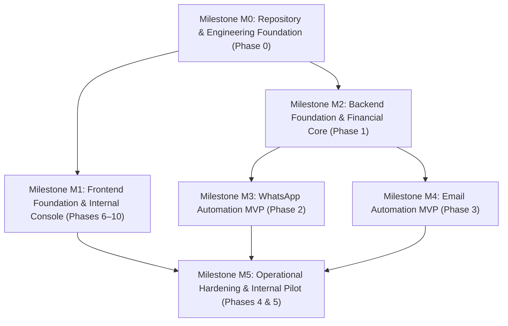
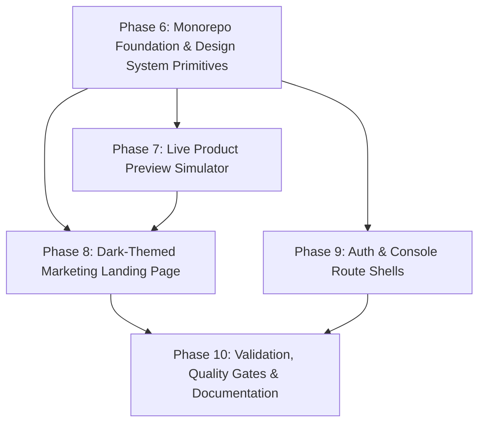

# Pathixo Flow - Project Roadmap

This phased execution roadmap defines the transition from architecture decisions to a hardened, repeatable production automation platform, aligned with our canonical **M0–M5 GitHub Engineering Milestones**.

---

## Engineering Milestone Mapping Overview

| GitHub Milestone | Milestone Title | ROADMAP Phases |
| :---: | :--- | :---: |
| **M0** | Repository and engineering foundation | Phase 0 |
| **M1** | Frontend foundation and internal console | Phases 6, 7, 8, 9, 10 |
| **M2** | Backend foundation and financial core | Phase 1 |
| **M3** | WhatsApp automation MVP | Phase 2 |
| **M4** | Email automation MVP | Phase 3 |
| **M5** | Operational hardening and internal pilot | Phases 4 & 5 |

---

## Phase 0: Technical Decisions & Repository Foundation (Milestone M0)

**Goal**: Establish authoritative architectural decisions through ADRs and scaffold the monorepo baseline with zero cross-application coupling.

* **Target Deliverables**:
  - `docs/decisions/ADR-001-runtime-and-monorepo.md`: Language & runtime choice (TypeScript/Node.js + `pnpm`).
  - `docs/decisions/ADR-002-database-and-orm.md`: Persistence layer (PostgreSQL + Drizzle/Prisma).
  - `docs/decisions/ADR-003-queue-and-workers.md`: Durable queue engine (Redis + BullMQ).
  - `docs/decisions/ADR-004-client-isolation.md`: Client credential isolation and configuration hierarchy.
  - `docs/decisions/ADR-005-providers.md`: WhatsApp (Meta Cloud API) and Email (Amazon SES / Resend) adapter strategy.
  - Initial workspace configuration (`package.json`, `pnpm-workspace.yaml`, `tsconfig.json`).
  - Strict CI linting, formatting, type checking, and Git hooks.
* **Exit Criteria**:
  - Both applications can be scaffolded and built independently.
  - Shared package imports resolve cleanly across workspace boundaries.
  - CI pipeline checks run on affected packages only.

---

## Phase 1: Shared Reliability Foundation & Financial Ledger Core (Milestone M2)

**Goal**: Build the reusable execution primitives, background job processing, and P0 financial usage metering before building channel logic.

* **Target Deliverables**:
  - `packages/configuration`: Strict Zod schema validation for runtime configs, rejecting missing keys on startup with secret masking.
  - `packages/observability`: Structured JSON logging with correlation ID propagation and automated PII redaction.
  - `packages/queue`: Durable queue registration, worker abstractions, and job lifecycle management.
  - `packages/retry`: Bounded retry classification (transient vs. permanent failures) with exponential backoff and jitter.
  - `packages/billing-core`:
    - Immutable `UsageEvent` ledger schema.
    - Versioned, effective-dated `RateCard` registry.
    - Idempotency guard guaranteeing zero duplicate billable usage records.
    - Client quota verification and low-balance warning triggers.
  - `packages/testing`: Test harness with shared provider fakes and deterministic replay tests.
* **Exit Criteria**:
  - A sample asynchronous workflow can be ingested, validated, processed by a worker, retried on failure, deduplicated, and attributed to a client ledger locally.

---

## Phase 2: WhatsApp Automation Service (MVP) (Milestone M3)

**Goal**: Deliver a production-ready, independently deployable WhatsApp automation service.

* **Target Deliverables**:
  - Provider webhook endpoint with cryptographic signature verification (`WA-001`).
  - Fast asynchronous webhook ingestion with sub-2s acknowledgement (`WA-002`, `CORE-006`).
  - Event normalization into internal domain events with deduplication (`WA-003`, `WA-004`).
  - Outbound message and template dispatch via decoupled `WhatsAppProvider` adapter (`WA-005`, `WA-010`).
  - Template parameter validation before dispatch (`WA-006`).
  - Consent and opt-out suppression check (`WA-008`).
  - Provider rate limiting and bounded retry handling (`WA-009`).
  - Reusable starter workflows: Inbound lead acknowledgement and appointment follow-up.
* **Exit Criteria**:
  - Valid inbound and internal triggers execute end-to-end against sandbox/provider fakes.
  - Every outbound WhatsApp message creates a validated, rate-card-priced `UsageEvent` in the financial ledger.

---

## Phase 3: Email Automation Service (MVP) (Milestone M4)

**Goal**: Deliver a production-ready, independently deployable Email automation service.

* **Target Deliverables**:
  - Decoupled `EmailProvider` adapter supporting Amazon SES and Resend (`EM-001`, `EM-007`).
  - Version-controlled template engine with strict variable validation (`EM-002`).
  - Idempotent send processing preventing duplicate emails (`EM-004`).
  - Webhook processing for bounces, complaints, deliveries, and unsubscribes (`EM-005`).
  - Automated suppression-list checks before dispatch (`EM-006`).
  - Rate limiting respecting client and provider quotas (`EM-008`).
  - Reusable starter workflows: Invoice/payment reminder and new lead acknowledgement.
* **Exit Criteria**:
  - An email workflow triggers, validates template variables, enforces suppression, dispatches, and logs normalized events.
  - Email sending creates an itemized usage record with verified provider unit counts.

---

## Phase 4: Client Delivery Hardening & Deployment Packs (Milestone M5)

**Goal**: Package the platform into a repeatable, low-friction deployment toolkit for client engagements.

* **Target Deliverables**:
  - Client onboarding discovery questionnaire and workflow specification templates.
  - Isolated client deployment packages (Docker Compose and container manifests).
  - Production readiness endpoints (`/health/live`, `/health/ready`) and startup self-checks (`CORE-010`).
  - Operator dead-letter queue inspection and guarded replay CLI (`CORE-009`).
  - Operational runbooks: Database backup/restore, credential rotation, and incident escalation.
* **Exit Criteria**:
  - A complete client environment can be provisioned, configured, and verified using documentation and templates alone, with zero manual ad-hoc tweaks.

---

## Phase 5: Cross-Channel Workflows & Operational Close (Milestone M5)

**Goal**: Support unified multi-channel client sequences and establish financial reconciliation tooling.

* **Target Deliverables**:
  - Combined WhatsApp + Email sequence templates (e.g. WhatsApp notification with Email fallback/receipt).
  - Monthly financial close tooling: compare internal usage ledgers with external provider invoices.
  - Shared cost allocation scripts dividing base infrastructure expenses across active clients.
  - Delivery metrics measurement (engineering hours per client delivery, template reuse ratio).
* **Exit Criteria**:
  - Multi-channel workflow executes cleanly with shared correlation ID.
  - Monthly reconciliation report demonstrates $\le 2\%$ variance against provider billing.

---

# Milestone M1 (v2.0): Frontend Foundation & Internal Console

## Phase Overview & Dependency Graph (Milestone M1)

---

## Phase 6: Monorepo Foundation & Design System Primitives

**Goal**: Scaffold the root pnpm workspace, establish the Next.js 15 App Router application in `apps/web`, configure dual-theme design tokens, and build reusable Radix UI primitives.

* **Target Deliverables**:
  - Root `package.json` with recursive workspace scripts (`dev`, `build`, `lint`, `typecheck`).
  - `pnpm-workspace.yaml` configuring `apps/*` and `packages/*`.
  - `packages/design-tokens`: Centralized color tokens, 4px grid, 2px–6px radii, CSS variables (`tokens.css`), and Tailwind CSS v4 preset (`preset.ts`).
  - `packages/ui`: Accessible Radix UI components (`Button`, `IconButton`, `Badge`, `StatusBadge`, `Dialog`, `Drawer`, `Card`, `Separator`, `Table`).
  - `apps/web`: Next.js 15 App Router setup with single global `app/layout.tsx` (Geist Sans & Geist Mono) and `transpilePackages`.
* **Requirements Mapped**: `ARCH-01`, `ARCH-02`, `ARCH-04`, `ARCH-05`, `DESIGN-01`, `DESIGN-02`, `DESIGN-03`, `DESIGN-04`
* **Success Criteria**:
  1. `pnpm install` resolves cleanly across workspace boundaries.
  2. `packages/ui` components render with correct design tokens and pass TypeScript typechecking.
  3. Anti-AI-slop invariants verified (no purple gradients, no glowing buttons, 4px geometry).

---

## Phase 7: Live Product Preview Simulator

**Goal**: Build an authentic, interactive, zero-raster-image product preview component modeling Pathixo Flow's 3-stage delivery pipeline using real React/SVG DOM elements.

* **Target Deliverables**:
  - Interactive window shell with realistic macOS/window titlebar and route context.
  - 3-Stage Pipeline Visualization:
    - Stage 1: Ingestion (Meta webhook HMAC-SHA256 signature verification pill, sub-20ms acknowledgement).
    - Stage 2: Queue & Worker (BullMQ job status, Redis `SETNX` idempotency lock, retry policy).
    - Stage 3: Financial Ledger (Attributed client billing row, category rate calculation, prepaid balance deduction).
  - Firewall-safe mock data (`+15550100` phone numbers, sanitized demo tokens).
  - Responsive scaling for desktop peek fold and mobile adaptation.
* **Requirements Mapped**: `PREVIEW-01`, `PREVIEW-02`, `PREVIEW-03`, `PREVIEW-04`
* **Success Criteria**:
  1. Product preview renders crisply on high-DPI displays with zero raster images.
  2. Interactive simulation controls demonstrate idempotency and ledger attribution.
  3. No firewall violation triggered by mock data.

---

## Phase 8: Dark-Themed Marketing Landing Page

**Goal**: Implement the complete, production-quality public marketing landing page inspired by Linear's dark visual aesthetic.

* **Target Deliverables**:
  - Sticky editorial dark navigation bar (`apps/web/app/(marketing)/_components/marketing-header.tsx`) with wordmark, desktop links, CTA, and accessible Radix mobile drawer.
  - High-impact editorial hero section with display headline ("Automate the work. Stay in control."), supporting description, dual CTAs, and integrated product preview peek.
  - Core capabilities section highlighting 6 pillars (Communication, Workflow, Integration, Monitoring, Client Isolation, Financial Ledger).
  - WhatsApp automation channel showcase (Meta Cloud API, approved templates, inbound ingestion, opt-out suppression).
  - Email automation channel showcase (SES/Resend, template rendering, bounce/complaint visibility).
  - Visual workflow automation pipeline illustration (Trigger $\to$ Condition $\to$ Action $\to$ Ledger).
  - Integrations, use cases, and engineering reliability & security section.
  - Multi-column footer with sitemap, copyright (Pathixo Pvt. Ltd.), legal links, and operational status pill.
* **Requirements Mapped**: `LANDING-01`, `LANDING-02`, `LANDING-03`, `LANDING-04`, `LANDING-05`, `LANDING-06`, `LANDING-07`, `LANDING-08`
* **Success Criteria**:
  1. Complete landing page rendered in dark theme (`#08090A`) with high typographic contrast and restrained terracotta accents.
  2. All navigation links and CTAs lead to working routes or accessible dialogs.
  3. Zero placeholder lorem ipsum, fabricated metrics, or generic AI-slop graphics.

---

## Phase 9: Auth & Console Route Shells

**Goal**: Establish the routing and layout architecture for the authentication experience and the authenticated engineering console with clear separation of concerns.

* **Target Deliverables**:
  - Route group segregation: `(marketing)` vs `(auth)` vs `(app)` with zero URL collisions (`ARCH-03`).
  - Authentication shell: Centered distraction-free layout on warm neutral canvas in `app/(auth)/layout.tsx`.
  - Auth placeholder routes: `/login`, `/forgot-password`, `/reset-password`, `/verify-email`.
  - Authenticated console shell: 240px collapsible sidebar, 48px header with breadcrumbs and command palette shortcut in `app/(app)/layout.tsx`.
  - Console placeholder routes: `/workspace`, `/workspace/whatsapp`, `/workspace/email`, `/workspace/workflows`, `/workspace/ledger`, `/workspace/operations`, `/workspace/settings`.
  - Search engine protection: `robots: { index: false, follow: false }` metadata guard on private route groups.
* **Requirements Mapped**: `ARCH-03`, `SHELL-01`, `SHELL-02`, `SHELL-03`, `SHELL-04`, `SHELL-05`
* **Success Criteria**:
  1. Navigating from marketing to `/login` or `/workspace` transitions cleanly without page reloads.
  2. Light theme (`#F7F7F4`) correctly applies to `(auth)` and `(app)` without theme bleeding from `(marketing)`.
  3. No-index robots directives prevent search indexing of private shells.

---

## Phase 10: Validation, Quality Gates & Documentation

**Goal**: Execute comprehensive build verification, linting, typechecking, accessibility audits, and synchronize all project documentation.

* **Target Deliverables**:
  - Production build verification (`pnpm -r run build`).
  - Strict typecheck (`pnpm -r run typecheck`) and lint (`pnpm -r run lint`) passing with zero errors.
  - WCAG 2.2 AA contrast compliance verification ($\ge 4.5:1$ text contrast).
  - Responsive audit across 1440px, 1024px, 768px, and 375px viewports.
  - Synchronized documentation:
    - `docs/ARCHITECTURE.md`: Monorepo structure, route groups, and package responsibilities.
    - `docs/DESIGN.md`: Dark marketing theme tokens, updated component standards.
    - `docs/RULES.md`: Coding conventions, component rules, and anti-AI-slop invariants.
    - `docs/TASKS.md`: Updated task backlog for v2.0 completion and v2.1 roadmap.
    - `docs/COMPONENTS.md`: Shared UI component inventory and usage guidelines.
* **Requirements Mapped**: `QUAL-01`, `QUAL-02`, `QUAL-03`, `QUAL-04`, `QUAL-05`
* **Success Criteria**:
  1. All CI checks pass locally and in GitHub Actions.
  2. Documentation accurately reflects the codebase without claiming unbuilt backend features exist.
  3. Application runs locally and is production-ready for subsequent backend integration.
