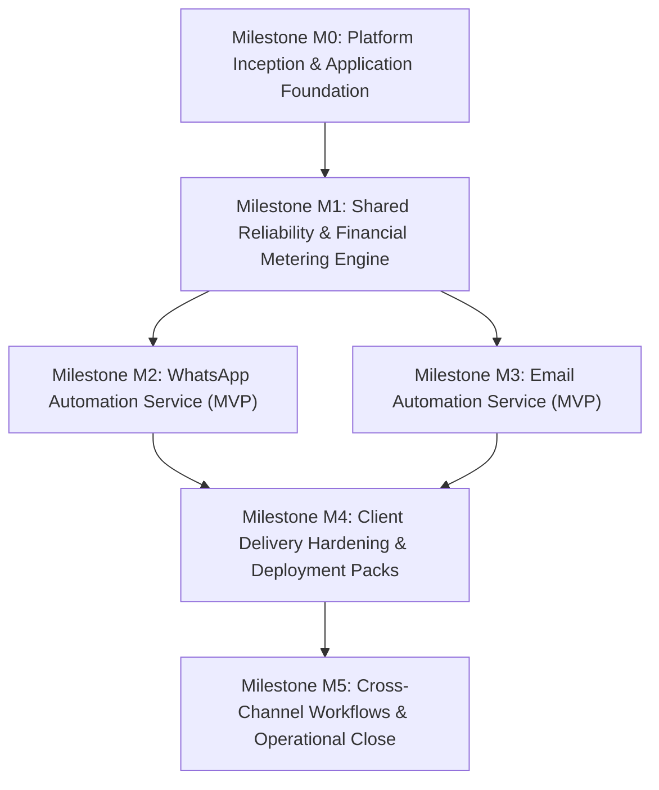

# Pathixo Flow - Project Roadmap

This phased execution roadmap defines the transition from architecture decisions to a hardened, repeatable production automation platform, organized by the canonical **M0–M5 Engineering Milestone Grouping**.

---

## Engineering Milestone Overview & Dependency Graph

---

## Milestone M0: Platform Inception & Application Foundation (Current)

**Goal**: Establish authoritative architectural decisions through ADRs, scaffold monorepo workspace tooling, configure dual-theme design tokens, build accessible Radix UI primitives, deliver the dark-themed marketing landing page with interactive preview simulator, and establish route shells.

### Track M0.A: Technical Decisions, Governance & Repository Foundation
* **Target Deliverables**:
  - `docs/decisions/ADR-001-runtime-and-monorepo.md`: Language & runtime choice (TypeScript/Node.js + `pnpm`).
  - `docs/decisions/ADR-002-database-and-orm.md`: Persistence layer (PostgreSQL + Drizzle).
  - `docs/decisions/ADR-003-queue-and-workers.md`: Durable queue engine (Redis + BullMQ).
  - `docs/decisions/ADR-004-client-isolation.md`: Client credential isolation and configuration hierarchy.
  - `docs/decisions/ADR-005-providers.md`: WhatsApp (Meta Cloud API) and Email (Amazon SES / Resend) adapter strategy.
  - Initial workspace configuration (`package.json`, `pnpm-workspace.yaml`, `tsconfig.base.json`).
  - Strict CI linting, formatting, type checking, security firewall, and Git hooks.
* **Exit Criteria**:
  - Monorepo tooling resolves cleanly across workspace boundaries.
  - CI pipeline checks run on affected packages.

### Track M0.B: Design System Primitives & Web Foundation (Phase 6)
* **Target Deliverables**:
  - `packages/design-tokens`: Centralized color tokens, 4px grid, 2px–6px radii, CSS variables (`tokens.css`), and Tailwind CSS v4 preset (`preset.ts`).
  - `packages/ui`: Accessible Radix UI components (`Button`, `Badge`, `Card`, `Dialog`, `Drawer`, `Separator`, `Skeleton`, `Table`).
  - `apps/web`: Next.js 15 App Router setup with global `app/layout.tsx` (Geist fonts) and `transpilePackages`.
* **Requirements Mapped**: `ARCH-01`, `ARCH-02`, `ARCH-04`, `ARCH-05`, `DESIGN-01`, `DESIGN-02`, `DESIGN-03`, `DESIGN-04`

### Track M0.C: Live Product Preview Simulator (Phase 7)
* **Target Deliverables**:
  - Interactive window shell modeling Pathixo Flow's 3-stage delivery pipeline (`apps/web/components/preview/`).
  - Stage 1: Ingestion (Meta webhook HMAC-SHA256 verification pill, sub-20ms acknowledgement).
  - Stage 2: Queue & Worker (BullMQ job status, Redis `SETNX` idempotency lock, retry policy).
  - Stage 3: Financial Ledger (Attributed client billing row, category rate calculation, balance deduction).
  - Firewall-safe mock data (`+15550100` RFC numbers, sanitized tokens).
* **Requirements Mapped**: `PREVIEW-01`, `PREVIEW-02`, `PREVIEW-03`, `PREVIEW-04`

### Track M0.D: Dark-Themed Marketing Landing Page (Phase 8)
* **Target Deliverables**:
  - Sticky editorial dark navigation bar (`marketing-header.tsx`) with wordmark, desktop links, CTA, and accessible mobile drawer.
  - Editorial hero section with display headline ("Automate the work. Stay in control.") and interactive product preview peek.
  - Core capabilities section highlighting 6 pillars (Communication, Workflow, Integration, Monitoring, Client Isolation, Financial Ledger).
  - Channel showcases for WhatsApp and Email with interactive tabs and perspective styling.
  - Visual workflow automation pipeline illustration (Trigger $\to$ Condition $\to$ Action $\to$ Ledger).
  - Multi-column footer with sitemap, copyright, legal links, and status indicator.
* **Requirements Mapped**: `LANDING-01` through `LANDING-08`

### Track M0.E: Auth & Console Route Shells (Phase 9 - In Progress)
* **Target Deliverables**:
  - Route group segregation: `(marketing)` vs `(auth)` vs `(app)` with zero URL collisions (`ARCH-03`).
  - Authentication shell: Centered distraction-free layout on warm neutral light canvas in `app/(auth)/layout.tsx`.
  - Auth placeholder routes: `/login`, `/forgot-password`, `/reset-password`, `/verify-email`.
  - Authenticated console shell: 240px collapsible sidebar, 48px header in `app/(app)/layout.tsx`.
  - Console placeholder routes: `/workspace`, `/workspace/whatsapp`, `/workspace/email`, `/workspace/ledger`.
  - Search engine protection: `robots: { index: false, follow: false }` metadata guard on private route groups.
* **Requirements Mapped**: `ARCH-03`, `SHELL-01`, `SHELL-02`, `SHELL-03`, `SHELL-04`, `SHELL-05`

### Track M0.F: Validation, Quality Gates & Documentation (Phase 10)
* **Target Deliverables**:
  - Production build verification (`pnpm -r run build`).
  - Strict typecheck (`pnpm -r run typecheck`) and lint (`pnpm -r run lint`) passing with zero errors.
  - WCAG 2.2 AA contrast compliance verification ($\ge 4.5:1$ text contrast).
  - Synchronized documentation reflecting exact codebase status.
* **Requirements Mapped**: `QUAL-01` through `QUAL-05`

---

## Milestone M1: Shared Reliability Foundation & Financial Ledger Core

**Goal**: Build the reusable execution primitives, background job processing, and P0 financial usage metering before building channel logic.

* **Target Deliverables**:
  - `packages/configuration`: Strict Zod schema validation for runtime configs, rejecting missing keys on startup with secret masking.
  - `packages/observability`: Structured JSON logging with correlation ID propagation and automated PII redaction.
  - `packages/queue`: Durable queue registration, worker abstractions, and job lifecycle management.
  - `packages/retry`: Bounded retry classification (transient vs. permanent failures) with exponential backoff and jitter.
  - `packages/billing-core`:
    - Immutable `UsageEvent` ledger schema.
    - Versioned, effective-dated `RateCard` registry.
    - Idempotency guard guaranteeing zero duplicate billable usage records.
    - Client quota verification and low-balance warning triggers.
  - `packages/testing`: Test harness with shared provider fakes and deterministic replay tests.
* **Exit Criteria**:
  - A sample asynchronous workflow can be ingested, validated, processed by a worker, retried on failure, deduplicated, and attributed to a client ledger locally.

---

## Milestone M2: WhatsApp Automation Service (MVP)

**Goal**: Deliver a production-ready, independently deployable WhatsApp automation service.

* **Target Deliverables**:
  - Provider webhook endpoint with cryptographic signature verification (`WA-001`).
  - Fast asynchronous webhook ingestion with sub-2s acknowledgement (`WA-002`, `CORE-006`).
  - Event normalization into internal domain events with deduplication (`WA-003`, `WA-004`).
  - Outbound message and template dispatch via decoupled `WhatsAppProvider` adapter (`WA-005`, `WA-010`).
  - Template parameter validation before dispatch (`WA-006`).
  - Consent and opt-out suppression check (`WA-008`).
  - Provider rate limiting and bounded retry handling (`WA-009`).
  - Reusable starter workflows: Inbound lead acknowledgement and appointment follow-up.
* **Exit Criteria**:
  - Valid inbound and internal triggers execute end-to-end against sandbox/provider fakes.
  - Every outbound WhatsApp message creates a validated, rate-card-priced `UsageEvent` in the financial ledger.

---

## Milestone M3: Email Automation Service (MVP)

**Goal**: Deliver a production-ready, independently deployable Email automation service.

* **Target Deliverables**:
  - Decoupled `EmailProvider` adapter supporting Amazon SES and Resend (`EM-001`, `EM-007`).
  - Version-controlled template engine with strict variable validation (`EM-002`).
  - Idempotent send processing preventing duplicate emails (`EM-004`).
  - Webhook processing for bounces, complaints, deliveries, and unsubscribes (`EM-005`).
  - Automated suppression-list checks before dispatch (`EM-006`).
  - Rate limiting respecting client and provider quotas (`EM-008`).
  - Reusable starter workflows: Invoice/payment reminder and new lead acknowledgement.
* **Exit Criteria**:
  - An email workflow triggers, validates template variables, enforces suppression, dispatches, and logs normalized events.
  - Email sending creates an itemized usage record with verified provider unit counts.

---

## Milestone M4: Client Delivery Hardening & Deployment Packs

**Goal**: Package the platform into a repeatable, low-friction deployment toolkit for client engagements.

* **Target Deliverables**:
  - Client onboarding discovery questionnaire and workflow specification templates.
  - Isolated client deployment packages (Docker Compose and container manifests).
  - Production readiness endpoints (`/health/live`, `/health/ready`) and startup self-checks (`CORE-010`).
  - Operator dead-letter queue inspection and guarded replay CLI (`CORE-009`).
  - Operational runbooks: Database backup/restore, credential rotation, and incident escalation.
* **Exit Criteria**:
  - A complete client environment can be provisioned, configured, and verified using documentation and templates alone, with zero manual ad-hoc tweaks.

---

## Milestone M5: Cross-Channel Workflows & Operational Close

**Goal**: Support unified multi-channel client sequences and establish financial reconciliation tooling.

* **Target Deliverables**:
  - Combined WhatsApp + Email sequence templates (e.g. WhatsApp notification with Email fallback/receipt).
  - Monthly financial close tooling: compare internal usage ledgers with external provider invoices.
  - Shared cost allocation scripts dividing base infrastructure expenses across active clients.
  - Delivery metrics measurement (engineering hours per client delivery, template reuse ratio).
* **Exit Criteria**:
  - Multi-channel workflow executes cleanly with shared correlation ID.
  - Monthly reconciliation report demonstrates $\le 2\%$ variance against provider billing.
