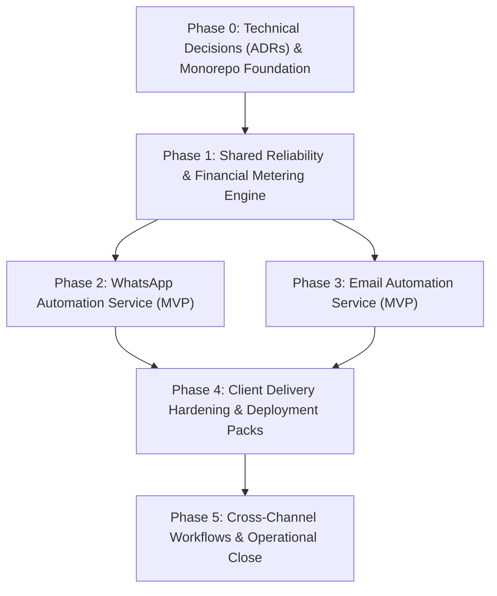

# Pathixo Flow - Project Roadmap

This phased execution roadmap defines the transition from architecture decisions to a hardened, repeatable production automation platform.

---

## Phase Overview & Dependency Graph

---

## Phase 0: Technical Decisions & Repository Foundation

**Goal**: Establish authoritative architectural decisions through ADRs and scaffold the monorepo baseline with zero cross-application coupling.

* **Target Deliverables**:
  - `docs/decisions/ADR-001-runtime-and-monorepo.md`: Language & runtime choice (TypeScript/Node.js + `pnpm`).
  - `docs/decisions/ADR-002-database-and-orm.md`: Persistence layer (PostgreSQL + Drizzle/Prisma).
  - `docs/decisions/ADR-003-queue-and-workers.md`: Durable queue engine (Redis + BullMQ).
  - `docs/decisions/ADR-004-client-isolation.md`: Client credential isolation and configuration hierarchy.
  - `docs/decisions/ADR-005-providers.md`: WhatsApp (Meta Cloud API) and Email (Amazon SES / Resend) adapter strategy.
  - Initial workspace configuration (`package.json`, `pnpm-workspace.yaml`, `tsconfig.json`).
  - Strict CI linting, formatting, type checking, and Git hooks.
* **Exit Criteria**:
  - Both applications can be scaffolded and built independently.
  - Shared package imports resolve cleanly across workspace boundaries.
  - CI pipeline checks run on affected packages only.

---

## Phase 1: Shared Reliability Foundation & Financial Ledger Core

**Goal**: Build the reusable execution primitives, background job processing, and P0 financial usage metering before building channel logic.

* **Target Deliverables**:
  - `packages/configuration`: Strict Zod schema validation for runtime configs, rejecting missing keys on startup with secret masking.
  - `packages/observability`: Structured JSON logging with correlation ID propagation and automated PII redaction.
  - `packages/queue`: Durable queue registration, worker abstractions, and job lifecycle management.
  - `packages/retry`: Bounded retry classification (transient vs. permanent failures) with exponential backoff and jitter.
  - `packages/billing-core`:
    - Immutable `UsageEvent` ledger schema.
    - Versioned, effective-dated `RateCard` registry.
    - Idempotency guard guaranteeing zero duplicate billable usage records.
    - Client quota verification and low-balance warning triggers.
  - `packages/testing`: Test harness with shared provider fakes and deterministic replay tests.
* **Exit Criteria**:
  - A sample asynchronous workflow can be ingested, validated, processed by a worker, retried on failure, deduplicated, and attributed to a client ledger locally.

---

## Phase 2: WhatsApp Automation Service (MVP)

**Goal**: Deliver a production-ready, independently deployable WhatsApp automation service.

* **Target Deliverables**:
  - Provider webhook endpoint with cryptographic signature verification (`WA-001`).
  - Fast asynchronous webhook ingestion with sub-2s acknowledgement (`WA-002`, `CORE-006`).
  - Event normalization into internal domain events with deduplication (`WA-003`, `WA-004`).
  - Outbound message and template dispatch via decoupled `WhatsAppProvider` adapter (`WA-005`, `WA-010`).
  - Template parameter validation before dispatch (`WA-006`).
  - Consent and opt-out suppression check (`WA-008`).
  - Provider rate limiting and bounded retry handling (`WA-009`).
  - Reusable starter workflows: Inbound lead acknowledgement and appointment follow-up.
* **Exit Criteria**:
  - Valid inbound and internal triggers execute end-to-end against sandbox/provider fakes.
  - Every outbound WhatsApp message creates a validated, rate-card-priced `UsageEvent` in the financial ledger.

---

## Phase 3: Email Automation Service (MVP)

**Goal**: Deliver a production-ready, independently deployable Email automation service.

* **Target Deliverables**:
  - Decoupled `EmailProvider` adapter supporting Amazon SES and Resend (`EM-001`, `EM-007`).
  - Version-controlled template engine with strict variable validation (`EM-002`).
  - Idempotent send processing preventing duplicate emails (`EM-004`).
  - Webhook processing for bounces, complaints, deliveries, and unsubscribes (`EM-005`).
  - Automated suppression-list checks before dispatch (`EM-006`).
  - Rate limiting respecting client and provider quotas (`EM-008`).
  - Reusable starter workflows: Invoice/payment reminder and new lead acknowledgement.
* **Exit Criteria**:
  - An email workflow triggers, validates template variables, enforces suppression, dispatches, and logs normalized events.
  - Email sending creates an itemized usage record with verified provider unit counts.

---

## Phase 4: Client Delivery Hardening & Deployment Packs

**Goal**: Package the platform into a repeatable, low-friction deployment toolkit for client engagements.

* **Target Deliverables**:
  - Client onboarding discovery questionnaire and workflow specification templates.
  - Isolated client deployment packages (Docker Compose and container manifests).
  - Production readiness endpoints (`/health/live`, `/health/ready`) and startup self-checks (`CORE-010`).
  - Operator dead-letter queue inspection and guarded replay CLI (`CORE-009`).
  - Operational runbooks: Database backup/restore, credential rotation, and incident escalation.
* **Exit Criteria**:
  - A complete client environment can be provisioned, configured, and verified using documentation and templates alone, with zero manual ad-hoc tweaks.

---

## Phase 5: Cross-Channel Workflows & Operational Close

**Goal**: Support unified multi-channel client sequences and establish financial reconciliation tooling.

* **Target Deliverables**:
  - Combined WhatsApp + Email sequence templates (e.g. WhatsApp notification with Email fallback/receipt).
  - Monthly financial close tooling: compare internal usage ledgers with external provider invoices.
  - Shared cost allocation scripts dividing base infrastructure expenses across active clients.
  - Delivery metrics measurement (engineering hours per client delivery, template reuse ratio).
* **Exit Criteria**:
  - Multi-channel workflow executes cleanly with shared correlation ID.
  - Monthly reconciliation report demonstrates $\le 2\%$ variance against provider billing.

