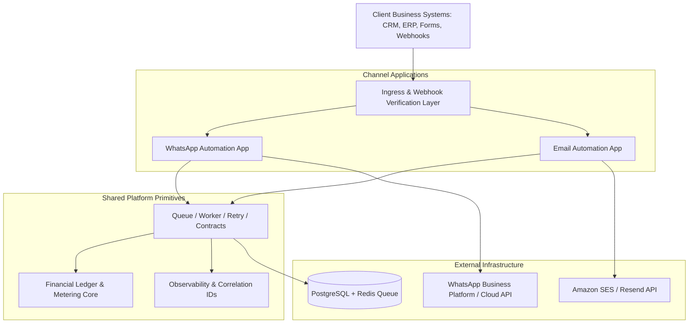

# Pathixo Flow

> **Internal engineering platform and reusable automation delivery toolkit for WhatsApp and Email business workflows.**

[](LICENSE)
[](https://pnpm.io/)
[](#)

---

## 1. Executive Overview

**Pathixo Flow** (formerly referenced internally as *Pathixo Automation Suite*) is an internal delivery platform developed by **Pathixo Pvt. Ltd.** It allows engineering teams to scope, configure, test, deploy, and operate repeatable client automations without rebuilding infrastructure from scratch for each engagement.

### Core Delivery Philosophy
> **Build the reusable 70–80% once, configure the common cases, and reserve custom development for client-specific business logic.**

The platform is **not** a public self-serve SaaS product and **not** a visual drag-and-drop workflow builder. It is a developer-operated, production-grade toolkit engineered to deliver reliable automation services with strict client isolation, deterministic idempotency, and automated financial cost attribution.

---

## 2. Core Capabilities & Architecture



* **Independently Deployable Applications**: WhatsApp and Email services maintain completely separate runtime containers and deployment lifecycles.
* **Isolated Client Boundary**: Secrets, credentials, customer data, and operational logs are strictly partitioned per client deployment.
* **Guaranteed Idempotency**: Persistent duplicate suppression across incoming webhooks and outgoing provider side-effects.
* **P0 Financial Usage Metering**: Immutable usage tracking by client, provider, market, and date-effective rate cards to ensure zero unbilled usage.

---

## 3. Repository Topology

The repository follows a clean monorepo structure designed for independent releases:

```text
pathixo-flow/
├── apps/
│   ├── whatsapp-automation/   # Independent WhatsApp event ingestion & dispatch service
│   └── email-automation/      # Independent transactional & workflow email service
├── packages/
│   ├── automation-contracts/  # Shared TypeScript types, event schemas & job definitions
│   ├── configuration/         # Strict schema validation & secret redaction
│   ├── queue/                 # Durable queue registration & worker abstraction
│   ├── retry/                 # Bounded exponential backoff & failure classification
│   ├── billing-core/          # P0 usage metering ledger & versioned rate cards
│   ├── observability/         # Structured JSON logging & correlation ID tracing
│   └── testing/               # Shared test fakes, fixtures & contract validators
├── clients/
│   └── examples/              # Standardized, validated client deployment templates
├── docs/                      # Architecture Decision Records (ADRs) & runbooks
├── .github/                   # Workflows, issue templates, and PR guidelines
└── .planning/                 # GSD governance, requirements & milestone tracking
```

---

## 4. Quickstart & Local Development

### Prerequisites
* **Node.js**: `v20.x` or `v22.x` (LTS)
* **Package Manager**: `pnpm >= 9.x`
* **Docker & Docker Compose** (for local PostgreSQL and Redis)

### Setup Instructions

1. **Clone the repository**:
   ```bash
   git clone https://github.com/pathixo/flow.git
   cd flow
   ```

2. **Install workspace dependencies**:
   ```bash
   pnpm install
   ```

3. **Start local infrastructure**:
   ```bash
   docker compose up -d
   ```

4. **Validate configuration & run typecheck**:
   ```bash
   pnpm run typecheck
   pnpm run test
   ```

5. **Run a specific channel service**:
   ```bash
   pnpm --filter @pathixo/whatsapp-automation dev
   # or
   pnpm --filter @pathixo/email-automation dev
   ```

---

## 5. Engineering Invariants & Quality Standards

* **Zero Committed Secrets**: Production credentials, provider API keys, and client secrets must never be committed to Git.
* **Validated Configuration**: Startup fails immediately if required configuration variables are missing or malformed.
* **Strict Type Safety**: All inter-service and provider payloads are strictly validated using schema validators (e.g. Zod).
* **Deterministic Provider Fakes**: All unit and integration test suites run against mock providers and local fixtures without making live billable API calls.

---

## 6. Documentation & Governance

* **[Contributing Guidelines](CONTRIBUTING.md)**: Monorepo workflow, branch naming, PR conventions, and code review rules.
* **[Code of Conduct](CODE_OF_CONDUCT.md)**: Professional standards and collaboration guidelines.
* **[Project Charter](.planning/PROJECT.md)**: Product goals, non-goals, and team responsibilities.
* **[Traceable Requirements](.planning/REQUIREMENTS.md)**: P0/P1/P2 requirement matrix from PRD v1.0 and Financial Plan v1.0.
* **[Roadmap](.planning/ROADMAP.md)**: Phased delivery plan from Phase 0 to Phase 5.

---

## 7. License & Ownership

Copyright © 2026 **Pathixo Pvt. Ltd.** All rights reserved.  
This software, documentation, and tooling are proprietary to Pathixo Pvt. Ltd. Unauthorized distribution or copying is strictly prohibited.

