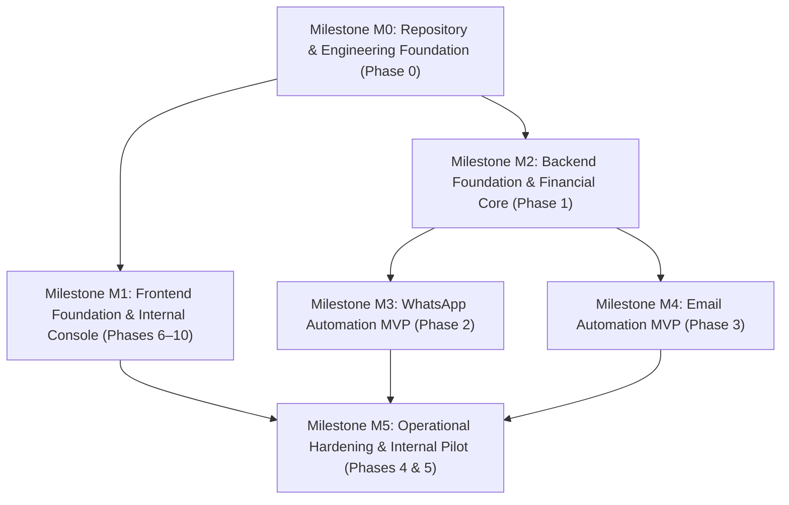

# Pathixo Flow - Project Roadmap

This document provides a high-level overview of our phased delivery roadmap aligned with the canonical **M0–M5 GitHub Engineering Milestones**.

For detailed requirement traceability, granular engineering tasks, and milestone cross-references, refer to:
* **[.planning/MILESTONES.md](.planning/MILESTONES.md)**: Official M0–M5 milestone mapping table and active tracking.
* **[.planning/ROADMAP.md](.planning/ROADMAP.md)**: Detailed phase execution structure (Phases 0–10).
* **[docs/TASKS.md](docs/TASKS.md)**: Actionable task checklist by milestone.
* **[.planning/REQUIREMENTS.md](.planning/REQUIREMENTS.md)**: Traceable P0/P1/P2 requirements matrix.

---

## Engineering Milestones Overview

### M0: Repository and Engineering Foundation
* Monorepo workspace tooling & CI baseline (`pnpm`, `apps/`, `packages/`).
* Formal Architecture Decision Records (`docs/DECISION.md`).
* High-level documentation suite (`docs/`).
* Automated security firewalls, Dependabot, and vulnerability scanners.

### M1: Frontend Foundation and Internal Console (Current)
* Design system tokens (`packages/design-tokens`) and accessible UI primitives (`packages/ui`).
* Production-grade dark-themed marketing landing page (`apps/web/app/(marketing)/`).
* Interactive 3-stage live product preview simulator (`preview-simulator.tsx`).
* Authentication and authenticated console route shells (`(auth)`, `(app)`).

### M2: Backend Foundation and Financial Core
* Runtime configuration validation with Zod and secret masking (`packages/configuration`).
* Structured JSON logging and correlation IDs (`packages/observability`).
* Durable BullMQ background queue with bounded retries (`packages/queue`, `packages/retry`).
* **P0 Financial Metering**: Immutable `UsageEvent` ledger and versioned rate cards (`packages/billing-core`).
* Test harness with deterministic provider fakes (`packages/testing`).

### M3: WhatsApp Automation MVP
* Meta WhatsApp Business Platform / Cloud API integration.
* Cryptographic HMAC webhook verification and async event ingestion.
* Outbound template validation and consent/opt-out suppression checks.
* Starter client workflows: Lead acknowledgement and appointment follow-up.

### M4: Email Automation MVP
* Decoupled Amazon SES and Resend provider adapters.
* Version-controlled email template engine with safe variable interpolation.
* Inbound bounce, complaint, and unsubscribe event processing.
* Starter client workflows: Payment reminders and onboarding notifications.

### M5: Operational Hardening and Internal Pilot
* Client onboarding templates and discovery checklists.
* Per-client isolated Docker Compose deployment manifests.
* Health/readiness checks and operator dead-letter queue (DLQ) replay CLI.
* Operational runbooks for backup/restore and credential rotation.
* Combined WhatsApp + Email sequence templates and monthly financial close reconciliation tooling.
