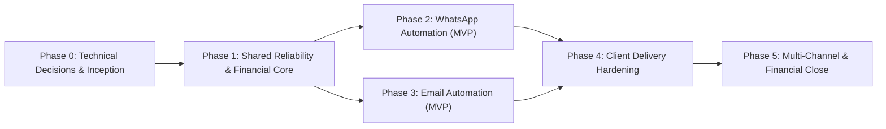

# Pathixo Flow - Project Roadmap

This document provides a high-level overview of our phased delivery roadmap.

For detailed requirement traceability and granular engineering tasks, refer to:
* **[docs/TASKS.md](docs/TASKS.md)**: Actionable task checklist by milestone.
* **[.planning/ROADMAP.md](.planning/ROADMAP.md)**: GSD phase structure and verification gates.
* **[.planning/REQUIREMENTS.md](.planning/REQUIREMENTS.md)**: Traceable P0/P1/P2 requirements matrix.

---

## Phased Milestones

### Phase 0: Technical Decisions & Repository Foundation (Current)
* Monorepo workspace tooling & CI baseline.
* Formal Architecture Decision Records (`docs/DECISION.md`).
* High-level documentation suite (`docs/`).
* Automated security firewalls, Dependabot, and 4x/day scheduled scans.

### Phase 1: Shared Reliability & Financial Metering Engine
* Configuration validation with Zod and secret masking (`packages/configuration`).
* Structured logging and correlation IDs (`packages/observability`).
* Durable BullMQ background queue with bounded retries (`packages/queue`, `packages/retry`).
* **P0 Financial Metering**: Immutable `UsageEvent` ledger and versioned rate cards (`packages/billing-core`).
* Test harness with deterministic provider fakes (`packages/testing`).

### Phase 2: WhatsApp Automation Service (MVP)
* Meta WhatsApp Business Platform / Cloud API integration.
* Cryptographic webhook verification and async event ingestion.
* Outbound template validation and consent checks.
* Starter client workflows: Lead acknowledgement and appointment follow-up.

### Phase 3: Email Automation Service (MVP)
* Decoupled Amazon SES and Resend provider adapters.
* Version-controlled email template engine with safe variable interpolation.
* Inbound bounce, complaint, and unsubscribe event processing.
* Starter client workflows: Payment reminders and onboarding notifications.

### Phase 4: Client Delivery Hardening & Deployment Packs
* Client onboarding templates and discovery checklists.
* Per-client isolated Docker Compose deployment manifests.
* Health/readiness checks and dead-letter replay CLI utility.
* Operational runbooks for backup/restore and credential rotation.

### Phase 5: Cross-Channel Workflows & Operational Close
* Combined WhatsApp + Email sequence templates.
* Monthly financial close tooling: internal usage vs. provider invoice reconciliation.
* Engineering hours and margin measurement.
