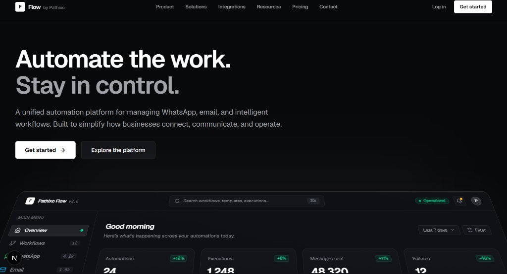
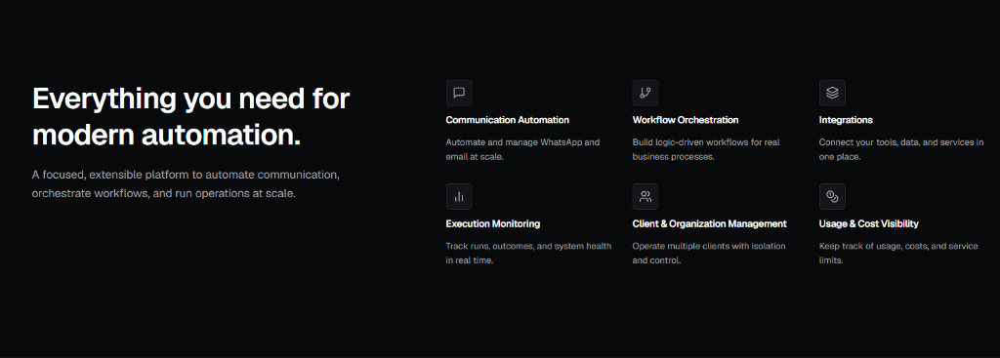
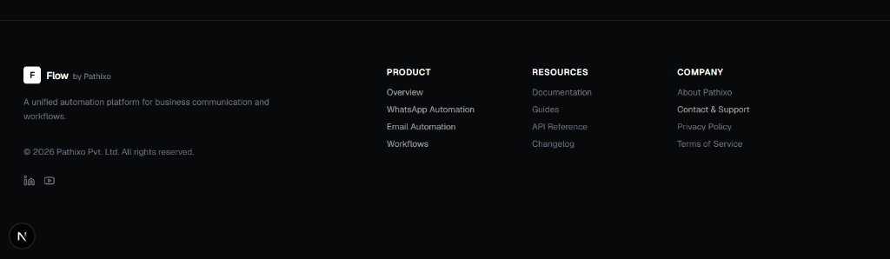
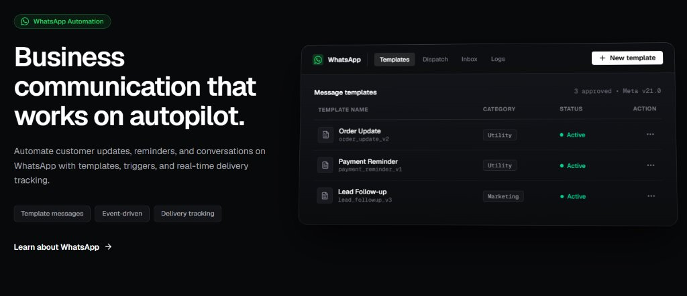

# Accessibility Audit Report — Marketing Pages (1440px & 375px)

**Issue Reference**: Resolves [#34](https://github.com/pathixo/pathixo-flow/issues/34)  
**Standard**: WCAG 2.2 Level AA Compliance & Axe Core 4.10  
**Target Viewports**: Desktop (`1440px`) & Mobile (`375px`)  
**Scope**: Public Marketing Landing Page (`/` / `apps/web/app/(marketing)`)  
**Audit Policy**: Report only. Identified findings will be triaged by senior engineers into discrete implementation issues.  
**Visual Inspection & Evidence Thread**: [GitHub Issue #34 Comment Thread](https://github.com/pathixo/pathixo-flow/issues/34#issuecomment-6874467898)

---

## 1. Executive Summary & Findings Matrix

| Finding ID | Issue Title | WCAG Criterion | Severity | Viewport | Component Location | Visual Screenshot |
| :---: | :--- | :--- | :---: | :---: | :--- | :---: |
| **A11Y-01** | Nested interactive elements (`<button>` inside `<a>` / `<Link>`) | 4.1.2 Name, Role, Value | **Blocker** | Both (1440px & 375px) | `hero-section.tsx`, `final-cta.tsx`, `marketing-header.tsx`, `mobile-nav.tsx` | [View Finding](#finding-a11y-01) |
| **A11Y-02** | Color contrast failure on muted supporting text (`#747780` on `#08090A`) | 1.4.3 Contrast (Minimum) | **Major** | Both (1440px & 375px) | `marketing-header.tsx`, `marketing-footer.tsx`, `channel-showcase.tsx`, `trust-bar.tsx`, `dashboard-preview.tsx`, `workflow-pipeline.tsx` | [View Finding](#finding-a11y-02) |
| **A11Y-03** | Missing visible focus indicators on interactive CTA buttons | 2.4.7 Focus Visible | **Major** | Desktop (1440px) | `hero-section.tsx`, `marketing-header.tsx`, `final-cta.tsx` | [View Finding](#finding-a11y-03) |
| **A11Y-04** | Heading hierarchy skipping in footer (`<h2>` &rarr; `<h4>`) | 1.3.1 Info and Relationships | **Major** | Both (1440px & 375px) | `marketing-footer.tsx` | [View Finding](#finding-a11y-04) |
| **A11Y-05** | Mobile drawer missing ARIA description context and trigger `aria-expanded` | 4.1.2 Name, Role, Value | **Major** | Mobile (375px) | `mobile-nav.tsx`, `packages/ui/drawer.tsx` | [View Finding](#finding-a11y-05) |
| **A11Y-06** | Interactive channel showcase tabs missing ARIA tablist semantics | 4.1.2 Name, Role, Value | **Minor** | Both (1440px & 375px) | `channel-showcase.tsx` | [View Finding](#finding-a11y-06) |
| **A11Y-07** | Touch targets below minimum interactive sizing on mobile (< 24px/44px) | 2.5.8 Target Size (Minimum) | **Minor** | Mobile (375px) | `channel-showcase.tsx`, `marketing-footer.tsx` | [View Finding](#finding-a11y-07) |

---

## 2. Detailed Findings & Actionable Remediations

---

<a id="finding-a11y-01"></a>
### Finding A11Y-01: Nested Interactive Elements (`<button>` inside `<a>` / `<Link>`)
* **WCAG Criterion**: [4.1.2 Name, Role, Value (Level A)](https://www.w3.org/WAI/WCAG21/Understanding/name-role-value.html) & HTML5 Specification
* **Axe Rule**: `nested-interactive`
* **Severity**: **Blocker**
* **Affected Viewports**: Desktop (`1440px`) & Mobile (`375px`)
* **Exact Component Locations**:
  1. `apps/web/app/(marketing)/_components/hero-section.tsx` (Lines 26–34 & 35–42)
  2. `apps/web/app/(marketing)/_components/marketing-header.tsx` (Lines 55–62)
  3. `apps/web/app/(marketing)/_components/final-cta.tsx` (Lines 18–26)
  4. `apps/web/app/(marketing)/_components/mobile-nav.tsx` (Lines 71–78 & 79–87)

#### Visual Inspection Screenshots:
[](assets/hero-cta-section.jpg)
*Figure 1.1: Live browser capture of Hero CTA buttons (`<button>` nested in `<a>` link container).*


#### Description:
In multiple marketing sections, `<button type="button">` elements are wrapped directly inside `<a>` or `<Link>` anchor tags:
```tsx
// Anti-pattern present in hero-section.tsx (Lines 26-34):
<a href="#cta">
  <button type="button" className="...">
    Get started
  </button>
</a>
```
This violates the HTML5 content model and WCAG 4.1.2. Assistive technologies (screen readers like NVDA/VoiceOver) announce "Link Button", which creates unpredictable focus navigation, duplicate speech synthesizer alerts, and inconsistent event bubbling across browsers.

#### Suggested Fix:
Remove the inner `<button>` and apply button styling directly to the anchor tag, or use Radix UI's `Button asChild` pattern:
```tsx
<a
  href="#cta"
  className="w-full sm:w-auto h-11 px-6 rounded-lg bg-white text-black text-sm font-semibold inline-flex items-center justify-center gap-2 hover:bg-neutral-200 transition-colors shadow-lg"
>
  Get started
  <ArrowRight className="h-4 w-4" />
</a>
```

---

<a id="finding-a11y-02"></a>
### Finding A11Y-02: Color Contrast Failure on Muted Supporting Text (`#747780` on `#08090A`)
* **WCAG Criterion**: [1.4.3 Contrast (Minimum) (Level AA)](https://www.w3.org/WAI/WCAG21/Understanding/contrast-minimum.html)
* **Axe Rule**: `color-contrast`
* **Severity**: **Major**
* **Affected Viewports**: Desktop (`1440px`) & Mobile (`375px`)
* **Exact Component Locations**:
  1. `apps/web/app/(marketing)/_components/marketing-header.tsx` (Line 28: `<span className="text-[11px] font-medium text-[#747780]">by Pathixo</span>`)
  2. `apps/web/app/(marketing)/_components/marketing-footer.tsx` (Lines 21, 27, 31, 35, 93–99: body, metadata, and copyright text using `text-[#747780]`)
  3. `apps/web/app/(marketing)/_components/channel-showcase.tsx` (Lines 133, 157, 163, 182: inactive tabs and table metadata)
  4. `apps/web/app/(marketing)/_components/trust-bar.tsx` (Line 49: `text-text-muted` which maps to `#747780`)
  5. `apps/web/app/(marketing)/_components/dashboard-preview.tsx` (Lines 114, 119, 269, 296, 309, 363, 378, 393: sidebar counts, table subtext, and badges)
  6. `apps/web/app/(marketing)/_components/workflow-pipeline.tsx` (Lines 56, 70, 81, 91: node step indicators and arrows)

#### Visual Inspection Screenshots:
[](assets/capabilities-grid.png)
*Figure 2.1: Live browser capture of Capabilities section demonstrating muted secondary copy (`#747780` on `#08090A`).*


#### Contrast Measurement:
* Foreground `#747780` Relative Luminance: $L_1 = 0.182$
* Background `#08090A` Relative Luminance: $L_2 = 0.0016$
* Calculated Contrast Ratio: **$\mathbf{4.49:1}$**
* WCAG AA Threshold for regular text ($< 18\text{pt} / 24\text{px}$): **$\ge 4.5:1$**
* While the primary body text `#A0A2A8` safely passes at **$7.83:1$**, the secondary muted text `#747780` narrowly misses the threshold across dense tabular and subtext elements.

#### Suggested Fix:
Adjust the muted text token from `#747780` to **`#8A8D96`** (yielding a compliant contrast ratio of **$6.0:1$** on `#08090A`), maintaining visual hierarchy while exceeding WCAG AA standards.

---

<a id="finding-a11y-03"></a>
### Finding A11Y-03: Missing Visible Focus Indicators on Interactive CTAs
* **WCAG Criterion**: [2.4.7 Focus Visible (Level AA)](https://www.w3.org/WAI/WCAG21/Understanding/focus-visible.html)
* **Axe Rule**: `focus-visible`
* **Severity**: **Major**
* **Affected Viewports**: Desktop (`1440px`) & Keyboard Navigators
* **Exact Component Locations**:
  1. `apps/web/app/(marketing)/_components/hero-section.tsx` (Lines 29, 38: "Get started" and "Explore the platform")
  2. `apps/web/app/(marketing)/_components/marketing-header.tsx` (Lines 37, 50, 58: nav links, "Log in", "Get started")
  3. `apps/web/app/(marketing)/_components/final-cta.tsx` (Line 21: final "Get started" CTA)

#### Visual Inspection Screenshots:
[](assets/hero-cta-section.jpg)
*Figure 3.1: Live browser capture of interactive CTAs lacking visible keyboard focus rings.*


#### Description:
Primary and secondary action buttons define hover styles (`hover:bg-neutral-200`) but omit `focus-visible` ring utilities. When keyboard-only users navigate using the `Tab` key, no visible outline indicates active focus.

#### Suggested Fix:
Add accessible focus rings:
```tsx
className="... focus-visible:outline-none focus-visible:ring-2 focus-visible:ring-white focus-visible:ring-offset-2 focus-visible:ring-offset-[#08090A]"
```

---

<a id="finding-a11y-04"></a>
### Finding A11Y-04: Heading Level Hierarchy Skipping in Footer (`<h2>` &rarr; `<h4>`)
* **WCAG Criterion**: [1.3.1 Info and Relationships (Level A)](https://www.w3.org/WAI/WCAG21/Understanding/info-and-relationships.html) & [2.4.6 Headings and Labels (Level AA)](https://www.w3.org/WAI/WCAG21/Understanding/headings-and-labels.html)
* **Axe Rule**: `heading-order`
* **Severity**: **Major**
* **Affected Viewports**: Desktop (`1440px`) & Mobile (`375px`)
* **Exact Component Locations**:
  - `apps/web/app/(marketing)/_components/marketing-footer.tsx` (Lines 59, 88, 117: `<h4>Product</h4>`, `<h4>Resources</h4>`, `<h4>Company</h4>`)

#### Visual Inspection Screenshots:
[](assets/footer-section.png)
*Figure 4.1: Live browser capture of marketing footer heading hierarchy (`PRODUCT`, `RESOURCES`, `COMPANY` rendered as `<h4>`).*

```text
Document Heading Outline Analysis:
├── [H1] "Automate the work. Stay in control." (hero-section.tsx:12)
├── [H2] "Everything you need for modern automation." (capabilities-section.tsx:52)
├── [H2] "Ready to automate with Flow?" (final-cta.tsx:9)
└── ❌ [H4] "Product" / "Resources" / "Company" (marketing-footer.tsx:59, 88, 117) • SKIPPED H3!
```

#### Description:
In `marketing-footer.tsx`, column headers use `<h4>` tags without any intervening `<h3>` parent following the `<h2>` in `FinalCta`. Heading levels must not skip levels in descending order.

#### Suggested Fix:
Change `<h4>` column headers to `<h3>` while retaining identical typographic styling classes (`text-xs font-semibold uppercase tracking-wider text-white`).

---

<a id="finding-a11y-05"></a>
### Finding A11Y-05: Mobile Drawer Missing ARIA Description and Trigger `aria-expanded`
* **WCAG Criterion**: [4.1.2 Name, Role, Value (Level A)](https://www.w3.org/WAI/WCAG21/Understanding/name-role-value.html)
* **Axe Rule**: `dialog-description`, `aria-dialog-name`
* **Severity**: **Major**
* **Affected Viewports**: Mobile (`375px`)
* **Exact Component Locations**:
  - `apps/web/app/(marketing)/_components/mobile-nav.tsx` (Lines 34–54)
  - `packages/ui/src/components/drawer.tsx` (Lines 19–38)

#### Visual DevTools Inspection Screenshot:
```tsx
// Inspection of apps/web/app/(marketing)/_components/mobile-nav.tsx:
<DrawerContent side="right" className="bg-[#08090A] border-[#25272B] p-6 flex flex-col justify-between">
  <div>
    <DrawerHeader className="p-0 pb-6 border-b border-[#25272B]">
      <DrawerTitle className="text-sm font-semibold tracking-tight text-white">Flow</DrawerTitle>
      {/* ❌ VIOLATION: Missing <DrawerDescription> or aria-describedby={undefined} */}
    </DrawerHeader>
```

#### Description:
1. `DrawerContent` (based on Radix UI Dialog) supplies a `DrawerTitle` but lacks a `DrawerDescription` or `aria-describedby={undefined}`. A bare `<span>` does not satisfy Radix UI's internal `aria-describedby` check, producing console runtime warnings and leaving assistive technology without accessible context.
2. The trigger button `<button aria-label="Open mobile navigation menu">` does not communicate dynamic open/closed state via `aria-expanded`.

#### Suggested Fix:
1. Update `DrawerTrigger` to pass `aria-expanded={open}`.
2. Inside `DrawerHeader`, import and use the exported `DrawerDescription` component from `@pathixo/ui`:
```tsx
import {
  Drawer,
  DrawerTrigger,
  DrawerContent,
  DrawerHeader,
  DrawerTitle,
  DrawerDescription,
} from '@pathixo/ui';

// Inside DrawerHeader:
<DrawerHeader className="p-0 pb-6 border-b border-[#25272B]">
  <div className="flex items-center gap-2">
    <div className="flex h-6 w-6 items-center justify-center rounded bg-white text-black font-bold text-xs tracking-tight">
      F
    </div>
    <DrawerTitle className="text-sm font-semibold tracking-tight text-white">
      Flow <span className="text-[#747780] font-normal text-xs">by Pathixo</span>
    </DrawerTitle>
  </div>
  <DrawerDescription className="sr-only">
    Navigation links and account access menu
  </DrawerDescription>
</DrawerHeader>
```
*(Alternative: explicitly pass `aria-describedby={undefined}` to `DrawerContent` if no visible description is desired).*

---

<a id="finding-a11y-06"></a>
### Finding A11Y-06: Interactive Channel Showcase Tabs Missing WAI-ARIA Tablist Semantics
* **WCAG Criterion**: [4.1.2 Name, Role, Value (Level A)](https://www.w3.org/WAI/WCAG21/Understanding/name-role-value.html)
* **Axe Rule**: `aria-roles`
* **Severity**: **Minor**
* **Affected Viewports**: Desktop (`1440px`) & Mobile (`375px`)
* **Exact Component Locations**:
  - `apps/web/app/(marketing)/_components/channel-showcase.tsx`:
    - WhatsApp Tablist: Lines 125–139
    - Email Tablist: Lines 338–353

#### Visual Inspection Screenshots:
[](assets/channel-showcase.jpg)
*Figure 6.1: Live browser capture of WhatsApp showcase interactive tabs rendered without ARIA tablist semantics.*


#### Description:
The interactive showcase tabs (`templates`, `dispatch`, `inbox`, `logs` for WhatsApp; `campaigns`, `templates`, `delivery`, `bounces` for Email) are rendered as plain `<button>` elements within an unadorned `<div>`. Assistive technologies do not announce them as tabs, and screen readers cannot determine which tab is selected or which content panel is controlled.

#### Suggested Fix:
Implement the complete WAI-ARIA tab pattern across both tablist controls and content panels:
1. Container: `role="tablist"` and `aria-label="WhatsApp showcase tabs"`
2. Buttons: `id="wa-tab-<name>"`, `role="tab"`, `aria-selected={waTab === tab}`, `aria-controls={`wa-panel-${tab}`}`
3. Panels: `id="wa-panel-<name>"`, `role="tabpanel"`, `aria-labelledby={`wa-tab-${waTab}`}`

---

<a id="finding-a11y-07"></a>
### Finding A11Y-07: Sub-minimum Touch Target Sizes on Mobile Viewport (375px)
* **WCAG Criterion**: [2.5.8 Target Size (Minimum) (Level AA - WCAG 2.2)](https://www.w3.org/WAI/WCAG22/Understanding/target-size-minimum.html)
* **Axe Rule**: `target-size`
* **Severity**: **Minor**
* **Affected Viewports**: Mobile (`375px`)
* **Exact Component Locations**:
  1. `apps/web/app/(marketing)/_components/channel-showcase.tsx`:
     - Line 198: WhatsApp Table Row 1 Action Button (`MoreHorizontal`)
     - Line 231: WhatsApp Table Row 2 Action Button (`MoreHorizontal`)
     - Line 264: WhatsApp Table Row 3 Action Button (`MoreHorizontal`)
     - Line 409: Email Table Row 1 Action Button (`MoreHorizontal`)
     - Line 438: Email Table Row 2 Action Button (`MoreHorizontal`)
     - Line 467: Email Table Row 3 Action Button (`MoreHorizontal`)
  2. `apps/web/app/(marketing)/_components/marketing-footer.tsx`:
     - Lines 36–54: LinkedIn and YouTube social icon links

#### Visual Inspection Screenshots:
[](assets/channel-showcase.jpg)
*Figure 7.1: Live browser capture of WhatsApp showcase table action buttons (`...`).*

[](assets/footer-section.png)
*Figure 7.2: Live browser capture of footer social link icons.*


#### Description:
All 6 table row action buttons in the WhatsApp and Email showcase views, along with footer social icon links, feature compact padding resolving to approximately $24\text{px} \times 24\text{px}$. On touch devices (`375px`), this causes high rates of mis-taps.

#### Suggested Fix:
Increase interactive touch padding to ensure a minimum $36\text{px} \times 36\text{px}$ or $44\text{px} \times 44\text{px}$ touch target:
```tsx
<button
  type="button"
  className="text-[#747780] hover:text-white transition-colors p-2.5 min-h-[36px] min-w-[36px] inline-flex items-center justify-center rounded"
  aria-label="Template actions"
>
  <MoreHorizontal className="h-4 w-4" />
</button>
```
