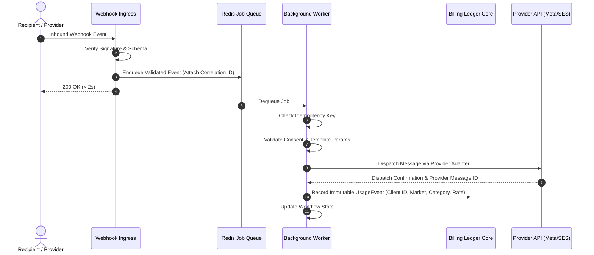

# Pathixo Flow - System Architecture

## 1. Architectural Overview & Topology

Pathixo Flow is architected as a modular monorepo containing independently deployable applications and shared infrastructure packages:

```mermaid
graph TD
    ClientCRM[Client Business Systems / Triggers] -->|Webhooks / API| Ingress[Ingress & Webhook Verification]

    subgraph Applications Layer (Independently Deployable)
        Ingress -->|Verify & Enqueue| WA[apps/whatsapp-automation]
        Ingress -->|Verify & Enqueue| EM[apps/email-automation]
    end

    subgraph Shared Platform Core (packages/)
        WA --> Contracts[packages/automation-contracts]
        EM --> Contracts
        WA --> Queue[packages/queue & retry]
        EM --> Queue
        WA --> Config[packages/configuration]
        EM --> Config
        WA --> Billing[packages/billing-core]
        EM --> Billing
        WA --> Obs[packages/observability]
        EM --> Obs
    end

    subgraph External Infrastructure
        WA -->|Meta Cloud API / BSP| MetaAPI[(Meta WhatsApp Business Platform)]
        EM -->|SMTP / API| EmailAPI[(Amazon SES / Resend)]
        Queue --> Redis[(Redis Queue)]
        Billing --> Postgres[(PostgreSQL DB)]
    end
```

---

## 2. Key Architecture Principles

1. **Independent Runtimes**: WhatsApp and Email services run as separate Node.js container processes. A failure or deployment in one never affects the other.
2. **Asynchronous Decoupling**: Inbound webhooks are validated and enqueued to Redis within 2 seconds; heavy processing and outbound dispatches are handled asynchronously by background workers.
3. **Persistent Idempotency**:
   - Inbound: Webhook event IDs are checked in Redis/Postgres before processing.
   - Outbound: Outbound message dispatches generate deterministic idempotency keys before invoking external provider APIs.
4. **Client-Level Isolation**:
   - Each client deployment runs in an isolated container/namespace with dedicated credentials.
   - All database queries and usage records enforce mandatory `clientId` scoping.
5. **Decoupled Provider Adapters**:
   - Business workflows interact with `WhatsAppProvider` and `EmailProvider` interfaces, ensuring switching between direct Meta Cloud API and BSPs (or SES and Resend) requires zero workflow code modification.

---

## 3. Data Flow & Execution Pipeline



---

## 4. Failure Classification & Retry Topology

| Failure Type | Examples | Strategy |
| :--- | :--- | :--- |
| **Transient** | Network timeout, Meta 500 error, provider rate limiting (429) | Bounded exponential backoff with jitter (max 5 attempts). |
| **Permanent** | Invalid recipient number, unapproved template, authorization failure (401/403) | Immediate terminal failure; alert operator; do not retry. |
| **Dead-Letter** | Exhausted transient retries | Move to Dead-Letter Queue (DLQ) with sanitized payload and failure reason for manual inspection. |
