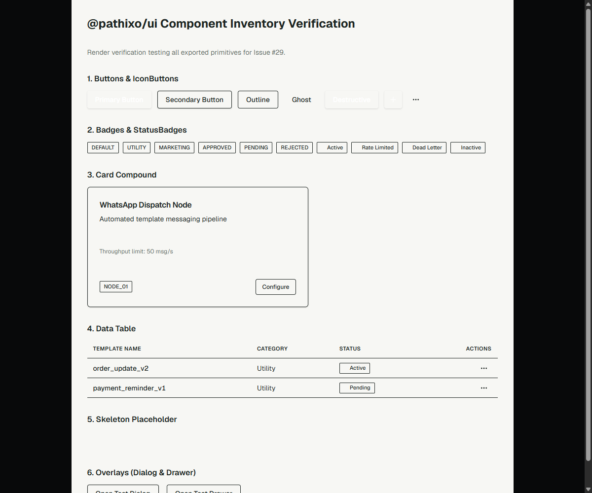

# Pathixo Flow — UI Component Inventory & Design Tokens

**Document Reference**: Resolves [#29](https://github.com/pathixo/pathixo-flow/issues/29)  
**Governance Requirement**: Mandated by `QUAL-05` & `DESIGN-03`  
**Package Source**: [`packages/ui`](../packages/ui) (`@pathixo/ui`)  
**Design Tokens**: [`packages/design-tokens`](../packages/design-tokens) (`@pathixo/design-tokens`) & [`docs/DESIGN.md`](./DESIGN.md)  
**Engineering Invariants**: [`docs/RULES.md`](./RULES.md) (Strict Anti-AI-Slop Prohibition)  

---

## 1. Component Inventory Matrix

| Component | Source File | Base Primitive | Key Variants / Sizes | Accessibility & Invariants |
| :--- | :--- | :--- | :--- | :--- |
| **`Button`** | `components/button.tsx` | Radix `Slot` (`asChild`) | `variant`: 6 styles<br>`size`: 5 options | `focus-visible:ring-2`, restrained 4px/6px radii |
| **`IconButton`** | `components/button.tsx` | `Button` wrapper | `size`: `icon`, `icon-sm` | Mandatory `aria-label`, `shrink-0` |
| **`Badge`** | `components/badge.tsx` | Native `<span>` | `variant`: 7 styles | Compact `text-[11px]`, `rounded-sm` (2px) |
| **`StatusBadge`** | `components/badge.tsx` | Native `<span>` | `status`: 5 semantic states | Color never used alone; pairs 6px dot or icon with text |
| **`Card`** | `components/card.tsx` | Native `<div>` compound | Compound primitives (Header, Title, etc.) | Anti-card-soup; restrained 6px/8px radii |
| **`Dialog`** | `components/dialog.tsx` | `@radix-ui/react-dialog` | Modal Dialog compound | Max width 540px, subtle backdrop blur, keyboard dismiss |
| **`Drawer`** | `components/drawer.tsx` | `@radix-ui/react-dialog` | `side`: `'left' \| 'right'` | Max width 440px, slide transitions (≤ 200ms) |
| **`Separator`** | `components/separator.tsx`| Native `<div>` | `orientation`: `'horizontal' \| 'vertical'` | 1px clean rule, semantic `role="separator"` vs decorative |
| **`Table`** | `components/table.tsx` | HTML `<table>` compound | Table, Header, Body, Row, Head, Cell | Dense `h-9`/`h-10`, `tabular-nums`, no zebra striping |
| **`Skeleton`** | `components/skeleton.tsx`| Native `<div>` | Animated pulse container | Content-shaped layout skeleton, not blocking spinners |

### 1.1 Visual Compilation & Verification
All documented JSX snippets below have been compiled and verified against `@pathixo/ui` and `@pathixo/design-tokens`:


*Figure 1.1: Live browser capture rendering all `@pathixo/ui` primitives (`Button`, `IconButton`, `Badge`, `StatusBadge`, `Card`, `Table`, `Separator`, `Skeleton`, `Dialog`, and `Drawer`).*

---

## 2. Component Specifications

### 2.1 Button

#### Purpose
Primary, secondary, outline, ghost, destructive, and text action trigger. Supports polymorphic rendering via Radix UI's `Slot` (`asChild`) pattern to cleanly wrap Next.js `<Link>` anchors without nesting `<button>` in `<a>`.

#### Import Path
```tsx
import { Button, buttonVariants, type ButtonProps } from '@pathixo/ui';
```

#### Props Table
| Prop | Type | Default | Description |
| :--- | :--- | :---: | :--- |
| `variant` | `'primary' \| 'secondary' \| 'outline' \| 'ghost' \| 'destructive' \| 'link'` | `'primary'` | Visual hierarchy styling. |
| `size` | `'sm' \| 'md' \| 'lg' \| 'icon' \| 'icon-sm'` | `'md'` | Dimensional scale (`sm`=32px, `md`=36px, `lg`=44px). |
| `asChild` | `boolean` | `false` | When true, renders child element directly using Radix UI `Slot`. |
| `className` | `string` | `undefined` | Optional Tailwind utility classes merged via `cn()`. |
| `...props` | `React.ButtonHTMLAttributes<HTMLButtonElement>` | — | Standard HTML button attributes (`onClick`, `disabled`, `type`, etc.). |

#### Real Usage Snippet
```tsx
import Link from 'next/link';
import { Button } from '@pathixo/ui';
import { ArrowRight } from 'lucide-react';

export function CallToAction() {
  return (
    <div className="flex items-center gap-3">
      <Button asChild size="lg">
        <Link href="#cta">
          Get started
          <ArrowRight className="h-4 w-4 ml-2" />
        </Link>
      </Button>
      <Button variant="secondary" size="lg">
        Explore platform
      </Button>
    </div>
  );
}
```

#### Design-Token Dependencies & Anti-AI-Slop Invariants
- **Color Tokens**: `bg-brand` (`#B85C38`), `hover:bg-brand-hover` (`#9E4D2C`), `bg-surface` (`#FFFFFF`), `border-border` (`#E4E7E1`), `text-text-primary` (`#1D2421`), `bg-danger` (`#B54747`).
- **Invariants**: 
  - Restrained rounding (`rounded-md`, 4px/6px). **No pill shapes**.
  - Visible keyboard ring: `focus-visible:ring-2 focus-visible:ring-brand focus-visible:ring-offset-2`.
  - Micro-interaction: `active:translate-y-[1px]` for tactile mechanical response.
  - **No glowing neon halos or purple gradients**.

---

### 2.2 IconButton

#### Purpose
Square dimensional button dedicated to single-icon actions (closing drawers, row ellipsis action menus, toolbar icons). Enforces accessibility by strictly requiring an `aria-label`.

#### Import Path
```tsx
import { IconButton, type IconButtonProps } from '@pathixo/ui';
```

#### Props Table
| Prop | Type | Default | Description |
| :--- | :--- | :---: | :--- |
| `aria-label` | `string` | **Required** | Accessible description read by screen readers. |
| `size` | `'icon' \| 'icon-sm' \| 'sm' \| 'md' \| 'lg'` | `'icon'` | Box dimensions (`icon` = 36px × 36px, `icon-sm` = 32px × 32px). |
| `variant` | `'primary' \| 'secondary' \| 'outline' \| 'ghost' \| 'destructive' \| 'link'` | `'primary'` | Inherited button visual variant. |
| `asChild` | `boolean` | `false` | Polymorphic slot trigger. |
| `className` | `string` | `undefined` | Merged utility classes (`shrink-0` applied by default). |
| `...props` | `ButtonProps` | — | Native button props. |

#### Real Usage Snippet
```tsx
import { IconButton } from '@pathixo/ui';
import { MoreHorizontal } from 'lucide-react';

export function TableRowActions() {
  return (
    <IconButton
      variant="ghost"
      size="icon-sm"
      aria-label="Open template actions menu"
    >
      <MoreHorizontal className="h-4 w-4 text-text-secondary" />
    </IconButton>
  );
}
```

#### Design-Token Dependencies & Anti-AI-Slop Invariants
- **Color Tokens**: `text-text-secondary`, `hover:text-text-primary`, `hover:bg-surface-subtle`.
- **Invariants**: Mandatory `aria-label` prevents icon-only buttons from failing WCAG 4.1.2. Strict square aspect ratio with `shrink-0`.

---

### 2.3 Badge

#### Purpose
Compact informational metadata tag used to indicate categories, channels, or static entity types (e.g., WhatsApp Template categories: `UTILITY`, `MARKETING`, `AUTHENTICATION`).

#### Import Path
```tsx
import { Badge, badgeVariants, type BadgeProps } from '@pathixo/ui';
```

#### Props Table
| Prop | Type | Default | Description |
| :--- | :--- | :---: | :--- |
| `variant` | `'default' \| 'secondary' \| 'brand' \| 'outline' \| 'destructive' \| 'success' \| 'warning'` | `'default'` | Semantic chromatic badge style. |
| `className` | `string` | `undefined` | Tailored utility classes. |
| `...props` | `React.HTMLAttributes<HTMLSpanElement>` | — | Standard span attributes. |

#### Real Usage Snippet
```tsx
import { Badge } from '@pathixo/ui';

export function TemplateCategory({ category }: { category: string }) {
  return (
    <Badge variant="secondary" className="uppercase">
      {category}
    </Badge>
  );
}
```

#### Design-Token Dependencies & Anti-AI-Slop Invariants
- **Color Tokens**: `bg-surface-subtle` (`#F0F1ED`), `text-text-primary` (`#1D2421`), `border-border` (`#E4E7E1`), `bg-brand/10 text-brand border-brand/20`.
- **Invariants**: 
  - Restrained 2px radius (`rounded-sm`). **Never full rounded pills**.
  - Font size strictly locked to `text-[11px]` font-medium with uppercase tracking.

---

### 2.4 StatusBadge

#### Purpose
Operational state tag communicating health, delivery lifecycle, or execution status (`Active`, `Paused`, `Failed`, `Queued`). Strictly satisfies WCAG 1.4.1 (Use of Color) by never relying on color alone.

#### Import Path
```tsx
import { StatusBadge, type StatusBadgeProps } from '@pathixo/ui';
```

#### Props Table
| Prop | Type | Default | Description |
| :--- | :--- | :---: | :--- |
| `status` | `'success' \| 'warning' \| 'danger' \| 'neutral' \| 'brand'` | **Required** | Operational lifecycle state. |
| `label` | `string` | **Required** | High-contrast visible text status label. |
| `icon` | `React.ReactNode` | `undefined` | Optional icon replacement for the default 6px circular dot. |
| `className` | `string` | `undefined` | Custom styling overrides. |
| `...props` | `React.HTMLAttributes<HTMLSpanElement>` | — | Standard span attributes. |

#### Real Usage Snippet
```tsx
import { StatusBadge } from '@pathixo/ui';

export function DispatchStatus({ status }: { status: 'success' | 'danger' | 'warning' }) {
  return (
    <StatusBadge
      status={status}
      label={status === 'success' ? 'Delivered' : status === 'warning' ? 'Retrying' : 'Failed'}
    />
  );
}
```

#### Design-Token Dependencies & Anti-AI-Slop Invariants
- **Color Tokens**: `bg-success` (`#2F7D5B`), `bg-warning` (`#A66A1F`), `bg-danger` (`#B54747`), `bg-brand` (`#B85C38`), `bg-text-muted` (`#939B95`).
- **Invariants**:
  - **Mandatory dual signaling**: Every status must have both a color indicator and an explicit text label.
  - 6px circular dot is tagged with `aria-hidden="true"` so screen readers only announce the label.
  - Restrained 2px bounding box (`rounded-sm`), avoiding bubbly roundness.

---

### 2.5 Dialog

#### Purpose
Centered modal dialog overlay for focused, high-stakes operator tasks (confirmations, deletion dialogs, template creator). Built on accessible `@radix-ui/react-dialog` primitives.

#### Import Path
```tsx
import {
  Dialog,
  DialogTrigger,
  DialogPortal,
  DialogOverlay,
  DialogContent,
  DialogHeader,
  DialogFooter,
  DialogTitle,
  DialogDescription,
  DialogClose,
} from '@pathixo/ui';
```

#### Compound Primitives & Props
| Primitive | Purpose | Key Props & Invariants |
| :--- | :--- | :--- |
| `Dialog` | Root state container | `open?: boolean`, `onOpenChange?: (open: boolean) => void` |
| `DialogTrigger` | Trigger button | `asChild?: boolean` |
| `DialogContent` | Modal card container | Max width 540px (`max-w-[540px]`), `p-6`, subtle shadow, Esc to dismiss |
| `DialogHeader` | Title & description container | Vertical stack with `space-y-1.5` |
| `DialogTitle` | Accessible dialog heading | `text-lg font-semibold text-text-primary` |
| `DialogDescription`| Contextual explanation | `text-sm text-text-secondary` (required for WCAG dialog context) |
| `DialogFooter` | Action buttons container | Responsive flex layout (`flex-col-reverse sm:flex-row sm:justify-end`) |
| `DialogClose` | Built-in top-right 'X' & actions | Focus-visible ring, accessible `<span className="sr-only">Close</span>` |

#### Real Usage Snippet
```tsx
import {
  Dialog,
  DialogTrigger,
  DialogContent,
  DialogHeader,
  DialogTitle,
  DialogDescription,
  DialogFooter,
  DialogClose,
  Button,
} from '@pathixo/ui';

export function DeleteConfirmationDialog() {
  return (
    <Dialog>
      <DialogTrigger asChild>
        <Button variant="destructive">Delete template</Button>
      </DialogTrigger>
      <DialogContent>
        <DialogHeader>
          <DialogTitle>Delete Message Template?</DialogTitle>
          <DialogDescription>
            This action cannot be undone. Active workflows referencing this template will fail.
          </DialogDescription>
        </DialogHeader>
        <DialogFooter>
          <DialogClose asChild>
            <Button variant="secondary">Cancel</Button>
          </DialogClose>
          <Button variant="destructive">Confirm deletion</Button>
        </DialogFooter>
      </DialogContent>
    </Dialog>
  );
}
```

#### Design-Token Dependencies & Anti-AI-Slop Invariants
- **Color Tokens**: `bg-surface` (`#FFFFFF`), `border-border` (`#E4E7E1`), `text-text-primary` (`#1D2421`), `bg-black/60`.
- **Invariants**:
  - Maximum width locked to 540px (`max-w-[540px]`).
  - Restrained backdrop blur (`backdrop-blur-[2px]`), **never heavy glassmorphism**.
  - Snappy duration transitions (150ms).

---

### 2.6 Drawer

#### Purpose
Slide-over side drawer panel sliding from the left or right edge. Used for responsive mobile navigation menus, inspector panels, and node configuration in workflow builders.

#### Import Path
```tsx
import {
  Drawer,
  DrawerTrigger,
  DrawerContent,
  DrawerHeader,
  DrawerTitle,
  DrawerDescription,
  DrawerClose,
} from '@pathixo/ui';
```

#### Props Table
| Primitive / Prop | Type | Default | Description |
| :--- | :--- | :---: | :--- |
| `Drawer` | Radix Dialog Root | — | Controls open/closed state. |
| `DrawerContent.side` | `'left' \| 'right'` | `'right'` | Drawer slide-in anchor edge. |
| `DrawerContent.className`| `string` | `undefined` | Width is constrained to `max-w-[440px]`. |
| `DrawerHeader` | `React.HTMLAttributes<HTMLDivElement>`| — | Top header container with bottom border. |
| `DrawerTitle` | Radix Dialog Title | — | High-contrast title (`text-lg font-semibold`). |
| `DrawerDescription` | Radix Dialog Description | — | Accessible context (use `sr-only` if visually hidden). |

#### Real Usage Snippet (Copied from `apps/web/.../mobile-nav.tsx`)
```tsx
import {
  Drawer,
  DrawerTrigger,
  DrawerContent,
  DrawerHeader,
  DrawerTitle,
  DrawerDescription,
  IconButton,
} from '@pathixo/ui';
import { Menu } from 'lucide-react';

export function MobileNavigation() {
  return (
    <Drawer>
      <DrawerTrigger asChild>
        <IconButton variant="secondary" size="icon" aria-label="Open navigation menu">
          <Menu className="h-4 w-4" />
        </IconButton>
      </DrawerTrigger>
      <DrawerContent side="right">
        <DrawerHeader>
          <DrawerTitle>Pathixo Flow</DrawerTitle>
          <DrawerDescription className="sr-only">
            Navigation links and account access
          </DrawerDescription>
        </DrawerHeader>
        <nav className="mt-6 flex flex-col space-y-3">
          <a href="#capabilities" className="text-sm font-medium text-text-secondary hover:text-text-primary">
            Capabilities
          </a>
          <a href="#channels" className="text-sm font-medium text-text-secondary hover:text-text-primary">
            Channels
          </a>
        </nav>
      </DrawerContent>
    </Drawer>
  );
}
```

#### Design-Token Dependencies & Anti-AI-Slop Invariants
- **Color Tokens**: `bg-surface` (`#FFFFFF`), `border-border` (`#E4E7E1`), `text-text-primary` (`#1D2421`).
- **Invariants**:
  - Maximum width locked to 440px (`max-w-[440px]`).
  - Linear slide transition timing: 200ms open, 150ms close.
  - Must include `<DrawerDescription>` or `aria-describedby={undefined}` to prevent Radix UI runtime accessibility warnings.

---

### 2.7 Card

#### Purpose
Elevated surface container for grouping related content (feature highlights, integration metrics, dashboard widgets).

#### Import Path
```tsx
import {
  Card,
  CardHeader,
  CardTitle,
  CardDescription,
  CardContent,
  CardFooter,
} from '@pathixo/ui';
```

#### Compound Primitives & Props
| Primitive | Element | Description |
| :--- | :---: | :--- |
| `Card` | `<div>` | Bounding container with `rounded-lg border border-border bg-surface text-text-primary shadow-sm`. |
| `CardHeader` | `<div>` | Top area with `p-6 flex flex-col space-y-1.5`. |
| `CardTitle` | `<h3>` | `text-base font-semibold leading-none tracking-tight text-text-primary`. |
| `CardDescription` | `<p>` | `text-sm text-text-secondary`. |
| `CardContent` | `<div>` | Body area with `p-6 pt-0`. |
| `CardFooter` | `<div>` | Bottom actions area with `flex items-center p-6 pt-0`. |

#### Real Usage Snippet
```tsx
import {
  Card,
  CardHeader,
  CardTitle,
  CardDescription,
  CardContent,
} from '@pathixo/ui';
import { MessageSquare } from 'lucide-react';

export function FeatureCard() {
  return (
    <Card>
      <CardHeader>
        <div className="flex items-center gap-2">
          <MessageSquare className="h-5 w-5 text-brand" />
          <CardTitle>Communication Automation</CardTitle>
        </div>
        <CardDescription>
          Automate WhatsApp and email at scale with verified templates.
        </CardDescription>
      </CardHeader>
      <CardContent>
        <p className="text-xs text-text-muted">Throughput: 1,200 msg/sec</p>
      </CardContent>
    </Card>
  );
}
```

#### Design-Token Dependencies & Anti-AI-Slop Invariants
- **Color Tokens**: `bg-surface`, `border-border`, `text-text-primary`, `text-text-secondary`.
- **Invariants**:
  - **Anti-Card-Soup Policy**: Only discrete features or standalone widgets may use cards; do not wrap raw text paragraphs or table rows in nested cards.
  - Restrained 6px corner radius (`rounded-lg`). **No gradient borders or outer glow filters**.

---

### 2.8 Separator

#### Purpose
1px clean dividing rule to establish spatial hierarchy between navigation items, table toolbars, or sections.

#### Import Path
```tsx
import { Separator, type SeparatorProps } from '@pathixo/ui';
```

#### Props Table
| Prop | Type | Default | Description |
| :--- | :--- | :---: | :--- |
| `orientation` | `'horizontal' \| 'vertical'` | `'horizontal'` | Axis of separation (`horizontal` = 1px high, `vertical` = 1px wide). |
| `decorative` | `boolean` | `true` | When true, renders `role="none"`. When false, announces `role="separator"` with `aria-orientation`. |
| `className` | `string` | `undefined` | Custom spacing utilities. |
| `...props` | `React.HTMLAttributes<HTMLDivElement>` | — | Standard div props. |

#### Real Usage Snippet
```tsx
import { Separator } from '@pathixo/ui';

export function NavigationToolbar() {
  return (
    <div className="flex items-center h-8 gap-4">
      <span className="text-sm font-medium">WhatsApp</span>
      <Separator orientation="vertical" className="h-4" />
      <span className="text-sm font-medium text-text-secondary">Email</span>
    </div>
  );
}
```

#### Design-Token Dependencies & Anti-AI-Slop Invariants
- **Color Tokens**: `bg-border` (`#E4E7E1`).
- **Invariants**: Exact 1px thickness. No colored glowing dividers or gradient fades.

---

### 2.9 Table

#### Purpose
High-density tabular grid for operational data, execution logs, message templates, and audit traces.

#### Import Path
```tsx
import {
  Table,
  TableHeader,
  TableBody,
  TableFooter,
  TableRow,
  TableHead,
  TableCell,
  TableCaption,
} from '@pathixo/ui';
```

#### Compound Primitives & Specifications
| Primitive | Tag | Typography & Geometry | Styling Invariants |
| :--- | :---: | :--- | :--- |
| `Table` | `<table>` | Wrapped in responsive `overflow-auto` container | `w-full border-collapse` |
| `TableHeader` | `<thead>` | `bg-surface-subtle border-b border-border` | Subtle background tint separating header |
| `TableHead` | `<th>` | `h-9 px-3 text-[11px] font-semibold uppercase tracking-wider text-text-secondary` | Compact 36px header height |
| `TableRow` | `<tr>` | `border-b border-border hover:bg-surface-subtle/50` | Row selection via `data-[state=selected]` |
| `TableCell` | `<td>` | `h-10 px-3 text-sm text-text-primary tabular-nums` | Dense 40px cell height with monospace numbers |
| `TableFooter` | `<tfoot>` | `bg-surface-subtle border-t border-border font-medium` | Totals and summaries |
| `TableCaption`| `<caption>`| `mt-4 text-xs text-text-muted` | Screen reader and visual description |

#### Real Usage Snippet
```tsx
import {
  Table,
  TableHeader,
  TableBody,
  TableRow,
  TableHead,
  TableCell,
  StatusBadge,
} from '@pathixo/ui';

export function MessageTemplateTable() {
  return (
    <Table>
      <TableHeader>
        <TableRow>
          <TableHead>Template Name</TableHead>
          <TableHead>Category</TableHead>
          <TableHead>Status</TableHead>
          <TableHead className="text-right">Throughput</TableHead>
        </TableRow>
      </TableHeader>
      <TableBody>
        <TableRow>
          <TableCell className="font-medium">order_update_v2</TableCell>
          <TableCell>Utility</TableCell>
          <TableCell>
            <StatusBadge status="success" label="Active" />
          </TableCell>
          <TableCell className="text-right">1,240 msg/s</TableCell>
        </TableRow>
      </TableBody>
    </Table>
  );
}
```

#### Design-Token Dependencies & Anti-AI-Slop Invariants
- **Color Tokens**: `bg-surface-subtle` (`#F0F1ED`), `border-border` (`#E4E7E1`), `text-text-primary` (`#1D2421`), `text-text-secondary` (`#68716B`).
- **Invariants**:
  - Mandatory `tabular-nums` on table cells for vertically aligned numerics.
  - **No zebra striping**: clean 1px horizontal borders only.
  - Dense compact height: `h-9` for headers, `h-10` for content cells.

---

### 2.10 Skeleton

#### Purpose
Content-shaped placeholder container used during asynchronous data retrieval. Fulfills the mandatory loading-state invariant in `RULES.md` Section 1.2 without blocking the user interface with modal spinners.

#### Import Path
```tsx
import { Skeleton } from '@pathixo/ui';
```

#### Real Usage Snippet
```tsx
import { Skeleton } from '@pathixo/ui';

export function TableRowSkeleton() {
  return (
    <div className="flex items-center space-x-4 p-4">
      <Skeleton className="h-6 w-24" />
      <Skeleton className="h-4 w-48" />
      <Skeleton className="h-4 w-16 ml-auto" />
    </div>
  );
}
```

---

## 3. Design Tokens & Anti-AI-Slop Governance Matrix

All `@pathixo/ui` components strictly implement the tokens exported by `@pathixo/design-tokens`:

| Token Category | Token Variable | Approved Hex / Metric | Component Application |
| :--- | :--- | :---: | :--- |
| **Canvas** | `colors.light.canvas` | `#F7F7F4` | Viewport backdrop, outer application frame. |
| **Surface** | `colors.light.surface` | `#FFFFFF` | Cards, Dialogs, Drawers, Table body. |
| **Subtle Surface** | `colors.light.surfaceSubtle` | `#F0F1ED` | Table headers, Badges, Skeleton placeholders. |
| **Border** | `colors.light.border` | `#E4E7E1` | Card outlines, Separators, Table borders. |
| **Text Primary** | `colors.light.textPrimary` | `#1D2421` | Headings, Table cell copy, Primary button text. |
| **Text Secondary**| `colors.light.textSecondary` | `#68716B` | Meta labels, Table heads, Card descriptions. |
| **Text Muted** | `colors.light.textMuted` | `#939B95` | Captions, disabled labels, placeholder icons. |
| **Brand Accent** | `colors.light.brand` | `#B85C38` | Primary button background, focus rings. |
| **Brand Hover** | `colors.light.brandHover` | `#9E4D2C` | Primary button hover state. |
| **Success** | `colors.light.success` | `#2F7D5B` | StatusBadge active dot and success borders. |
| **Warning** | `colors.light.warning` | `#A66A1F` | StatusBadge retry/warning state. |
| **Danger** | `colors.light.danger` | `#B54747` | Destructive button, error status dot. |
| **Radii** | `radii.sm` / `md` / `lg` | `2px` / `4px` / `6px` | Restrained geometry; pill shapes prohibited. |
| **Grid Unit** | `spacing.1` | `4px` | Strict 4px base increment for all component padding. |

---

## 4. Component Gaps, Inconsistencies & Technical Debt

This section catalogs technical debt and API discrepancies identified during the inventory audit for senior engineering prioritization:

1. **Marketing Dogfooding Gap (High Priority)**:
   - Several components in `apps/web/app/(marketing)/_components` (e.g., `hero-section.tsx`, `channel-showcase.tsx`, `marketing-footer.tsx`) construct raw HTML buttons (`<button>`) and inline tables instead of importing `Button`, `StatusBadge`, and `Table` from `@pathixo/ui`.
   - **Recommendation**: Refactor marketing views to dogfood `@pathixo/ui` to guarantee unified focus indicators and accessibility fixes.

2. **`IconButton` Size Prop Typing**:
   - `IconButtonProps` extends `ButtonProps`, meaning it technically accepts non-square text sizes like `size="md"` or `size="lg"`, which creates unbalanced padding when wrapping an icon.
   - **Recommendation**: Narrow `IconButtonProps['size']` strictly to `'icon' | 'icon-sm'`.

3. **Missing Empty & Loading States in `Table`**:
   - `Table` currently exports structural tags (`TableHeader`, `TableBody`, etc.) but provides no standardized `<TableEmptyState>` or `<TableSkeleton>` compound primitive, forcing consumers to construct custom empty rows.
   - **Recommendation**: Add `<TableEmpty>` and `<TableLoading>` primitives in `@pathixo/ui`.

4. **Dialog & Drawer Accessibility Warning Guards**:
   - Radix UI triggers runtime console warnings if `<DialogDescription>` or `<DrawerDescription>` is omitted from a dialog tree.
   - **Recommendation**: Add a fallback default `aria-describedby={undefined}` in `DialogContent` / `DrawerContent` when no description child is passed.

5. **Skeleton Documentation in Architecture Specs**:
   - `Skeleton` is implemented in `packages/ui/src/components/skeleton.tsx` and exported in `index.ts`, but was omitted from the initial list of 9 primitives in `.planning/REQUIREMENTS.md` (`DESIGN-03`).
   - **Recommendation**: Reconcile `DESIGN-03` to formally recognize `Skeleton` as a 10th core UI primitive.
