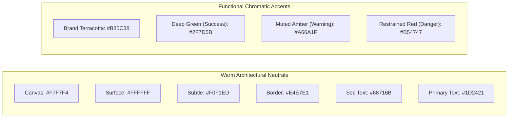
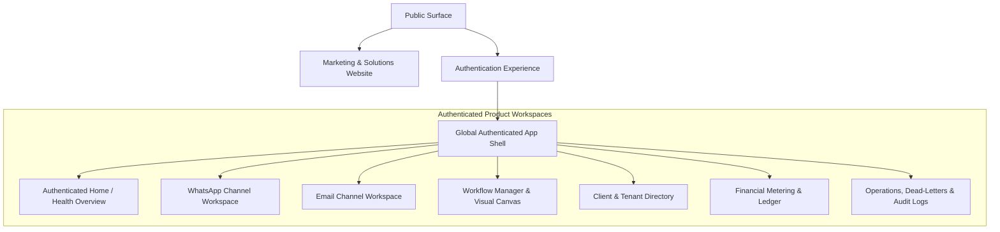

# Pathixo Flow - Comprehensive Product Design Specification

**Document Version**: 2.0  
**Status**: Authoritative Product Design Specification  
**Design System Baseline**: Warm Neutral Foundation, Terracotta Restrained Accent, Information-Dense Editorial UI  
**Design Quality Target**: Linear / Stripe / Raycast level craft, purpose-built for high-reliability business automation.

---

## 1. Executive Summary & Design Vision

Pathixo Flow is an internal engineering platform and reusable automation delivery suite built for developers and operators to deploy, monitor, and scale WhatsApp and Email automations with absolute reliability and cost attribution.

### 1.1 Visual Identity & Product Personality
- **Minimalist & Editorial**: Crisp typography, high contrast, clean division lines, and generous whitespace balanced with dense, legible tabular data.
- **Visually Quiet & Restrained**: The UI acts as a calm, distraction-free instrument. It avoids flashing lights, decorative fluff, or superfluous animations.
- **Information-Dense**: Operational dashboards present high-utility status indicators, throughput metrics, queue latencies, and financial ledger logs without forcing the operator to page through layers of decorative cards.
- **Deliberate Geometry**: A unified 4px spatial grid with subtle, functional corner radii (2px–6px) rather than ubiquitous pill shapes.

### 1.2 Anti-AI-Slop Prohibition (Strictly Enforced)
To preserve professional integrity and ensure long-term design longevity, the following patterns are **permanently prohibited**:
1. **No Purple-to-Blue or Pink Gradients**: Strictly forbid generic AI SaaS branding gradients.
2. **No Neon Cyan / Violet Glows**: No glowing outer box-shadows or neon button rings.
3. **No Decorative Glassmorphism**: No semi-transparent frosted cards or heavy background blurs (`backdrop-blur-md`) across standard data views.
4. **No Floating Blobs or 3D Illustrations**: Eliminate random blurred spheres, abstract 3D clay figures, or stock tech vectors.
5. **No Rainbow Charts**: Data visualizations must use restrained monochromatic or functional semantic palettes.
6. **No "Card Soup"**: Avoid wrapping every individual paragraph or counter in a rounded bordered box. Leverage whitespace, rules, and semantic tables.
7. **No Gratuitous Animations**: Transitions must be snappy ($\le 150\text{ms}$), functional, and respect `prefers-reduced-motion`.

---

## 2. Coherent Color System & Design Tokens

The color system uses a light-first theme built upon warm architectural neutrals, deep ink text, and a restrained terracotta brand accent.

### 2.1 Color Palette Tokens

| Token Name | Hex Code | Purpose / Application |
| :--- | :---: | :--- |
| `color-canvas` | `#F7F7F4` | Primary viewport background; warm off-white reducing eye strain. |
| `color-surface` | `#FFFFFF` | Work area cards, tables, modal dialogs, and elevated components. |
| `color-surface-subtle`| `#F0F1ED` | Table headers, secondary toolbars, disabled containers, and code tags. |
| `color-border` | `#E4E7E1` | Standard structural dividers, card outlines, and table cell borders. |
| `color-border-subtle` | `#ECEEE9` | Internal soft separators and inactive tab lines. |
| `color-text-primary` | `#1D2421` | High-contrast deep ink for headings, body copy, and active labels. |
| `color-text-secondary`| `#68716B` | Meta labels, timestamps, table header titles, and helper notes. |
| `color-text-muted` | `#939B95` | Placeholder text, disabled inputs, and breadcrumb dividers. |
| `color-brand` | `#B85C38` | Restrained terracotta; primary CTA buttons, active selection rings, and key focal points. |
| `color-brand-hover` | `#9E4D2C` | Hover state for primary brand buttons. |
| `color-brand-subtle`| `#F8EFEA` | Brand badge backgrounds and active sidebar item backgrounds. |
| `color-success` | `#2F7D5B` | Deep forest green; verified webhooks, delivered messages, and healthy workers. |
| `color-success-bg` | `#EDF6F1` | Background tint for success status badges and banners. |
| `color-warning` | `#A66A1F` | Muted amber; rate-limit throttles, prepaid low-balance warnings (25%), retrying jobs. |
| `color-warning-bg` | `#FBF4EB` | Background tint for warning badges and alerts. |
| `color-danger` | `#B54747` | Restrained crimson; exhausted dead-letters, signature verification failures, stopped queues. |
| `color-danger-bg` | `#FBEFEF` | Background tint for error banners and destructive dialogs. |

### 2.2 Color Usage Invariants
- **Never Communicate Status by Color Alone**: A green badge must always include text (`Delivered`) or an identifiable icon. An error state must display clear copy (`Failed: E.164 Invalid`).
- **Dark Mode Strategy**: Documented as a secondary, deferred theme. The light theme must be finalized with optimal WCAG contrast before creating a dark mode palette.

---

## 3. Typography System

**Primary Typeface**: **Geist Sans** (fallback: `-apple-system, BlinkMacSystemFont, 'Inter', 'Segoe UI', sans-serif`).  
**Monospace Typeface**: **Geist Mono** / `JetBrains Mono` for IDs, phone numbers, JSON payloads, and timestamps.

### 3.1 Type Hierarchy Scale

| Level | Size | Weight | Line Height | Letter Spacing | Application |
| :--- | :---: | :---: | :---: | :---: | :--- |
| **Display** | 32px | 600 SemiBold | 38px | `-0.02em` | Marketing Hero, Milestone Landing Titles. |
| **Page Title** | 22px | 600 SemiBold | 28px | `-0.015em` | Application page headers (e.g. "WhatsApp Workspace"). |
| **Section Header**| 16px | 600 SemiBold | 22px | `-0.01em` | Card titles, drawer headers, settings section titles. |
| **Subheading** | 14px | 500 Medium | 20px | `0` | Fieldset legends, modal sub-headers, widget labels. |
| **Body (Default)** | 14px | 400 Regular | 20px | `0` | Primary application text, table rows, form inputs. |
| **Body Strong** | 14px | 500 Medium | 20px | `0` | Active navigation links, emphasis within data tables. |
| **Secondary** | 12px | 400 Regular | 16px | `0` | Timestamps, secondary descriptions, helper instructions. |
| **Table Header** | 11px | 600 SemiBold | 14px | `+0.04em` | Uppercase table headers (`CORRELATION ID`, `STATUS`). |
| **Badge / Label** | 11px | 500 Medium | 14px | `+0.02em` | Status tags, category labels (`UTILITY`, `AUTHENTICATION`). |
| **Code / Mono** | 12px | 400 Regular | 16px | `0` | Idempotency keys, provider message IDs, payload previews. |

---

## 4. Spacing, Geometry & Component Metrics

### 4.1 4px Spacing Grid
All paddings, margins, and gaps must be multiples of **4px**:
* `space-1` (4px): Micro gaps between icon and label.
* `space-2` (8px): Compact item padding in dropdown menus and compact table cells.
* `space-3` (12px): Standard button horizontal padding, form field gaps.
* `space-4` (16px): Card interior padding, standard grid gaps.
* `space-6` (24px): Page gutter margins, section dividers.
* `space-8` (32px): Distance between independent dashboard widget rows.
* `space-12` (48px): Marketing section vertical separations.

### 4.2 Component Geometry & Elevation
* **Border Radii**:
  - `radius-sm` (2px): Code chips, micro status tags.
  - `radius-md` (4px): Standard buttons, text inputs, dropdown containers.
  - `radius-lg` (6px): Modal dialogs, flyout drawers, primary dashboard cards.
  - *Prohibition*: No `rounded-full` pills for standard cards or operational containers.
* **Borders & Dividers**:
  - Use `1px solid #E4E7E1` for clean architectural separation.
* **Shadows & Elevation**:
  - `shadow-subtle`: `0 1px 2px rgba(29, 36, 33, 0.04)` (Cards, resting containers).
  - `shadow-elevated`: `0 4px 12px rgba(29, 36, 33, 0.08)` (Dropdown menus, popovers).
  - `shadow-modal`: `0 12px 32px rgba(29, 36, 33, 0.12)` (Modal dialogs, command palettes).

---

## 5. Complete Product Page Architecture

---

### 5.1 Marketing Website Architecture (Public Experience)
* **Goal**: Establish immediate authority as a developer-operated, enterprise-grade business automation delivery platform.
* **Pages**:
  1. **Landing Page**:
     - *Hero*: Restrained headline ("Repeatable business automations engineered for WhatsApp and Email").
     - *Product Architecture Preview*: Live interactive visual preview showing webhook verification, worker queues, and rate-card metering.
     - *Core Pillars*: Independent runtime containers, P0 financial ledger, zero credential leaks, and high-reliability background queues.
     - *Channel Capabilities*: WhatsApp Cloud API (templates, opt-in checks) & Email (SES/Resend delivery, bounce handlers).
  2. **WhatsApp Automation Page**: Deep-dive into Meta Cloud API integrations, template lifecycles, and 24-hour customer service session management.
  3. **Email Automation Page**: Deliverability features, SPF/DKIM verification, and suppression-list guards.
  4. **Pricing & Service Architecture**: Transparent unit economics breakdown (Platform tier, Client tier, and Provider pass-through costs).
  5. **Documentation Entry Point**: Architecture guides, ADRs, and onboarding runbooks.

---

### 5.2 Authentication Experience (Dedicated & Secure)
* **Design Tone**: Clean, centered, distraction-free container on `color-canvas`. Zero marketing banners inside the login box.
* **Pages**:
  1. **Login**: Client ID / Email input, password field with show/hide toggle, "Remember this device" checkbox, and SSO button if enabled.
  2. **Forgot & Reset Password**: Time-bounded token entry, password strength indicator adhering to NIST guidelines.
  3. **Email Verification**: Clean 6-digit OTP entry field with auto-advance and countdown resend trigger.
  4. **Invitation Acceptance**: Organization joining confirmation with explicit role description.
  5. **Session Timeout & Access Denied (401/403)**: Clear actionable recovery button ("Re-authenticate session") preserving in-flight route.

---

### 5.3 Authenticated Global Application Shell
* **Left Navigation Sidebar (Width: 240px, Collapsible to 56px)**:
  - Top: Organization switcher (active client context).
  - Navigation Sections:
    - *Overview*: Home, Analytics.
    - *Channels*: WhatsApp, Email.
    - *Automation*: Workflows, Executions, Templates.
    - *Financials*: Usage Ledger, Rate Cards, Invoices.
    - *Operations*: Queues, Dead-Letters, Audit Logs, Settings.
  - Bottom: System status pill (All systems operational / 99.5% uptime) and user avatar profile.
* **Top Header Bar (Height: 48px)**:
  - Left: Contextual breadcrumbs (`Workspaces / Acme Corp / WhatsApp / Templates`).
  - Center: Global search shortcut (`Ctrl+K` / `⌘K` command palette).
  - Right: Quick Action button ("New Workflow"), Notification bell, and Help menu.

---

### 5.4 Authenticated Home Page (Operational Dashboard)
* **Target Audience**: Technical Implementers and Delivery Managers.
* **Key Sections**:
  1. **Automation Health Matrix**: 4 compact KPI cards (24h Inbound Webhooks, Outbound Delivered, P95 Ingestion Latency, Active Failed Jobs).
  2. **Channel Delivery Stream**: Side-by-side feed of live WhatsApp dispatches and Email events.
  3. **Provider Status Card**: Real-time health check pills for Meta Cloud API, Amazon SES, Redis, and Database.
  4. **Financial Burn Gauge**: Current billing period client spend vs. prepaid budget cap.

---

### 5.5 Visual Workflow Management & Canvas
* **Directory View**: Paginated data table listing active workflows with filters (`Channel`, `Status: Active/Draft`, `Trigger Type`).
* **Visual Workflow Canvas**:
  - *Canvas Controls*: Pan, zoom (25%–200%), fit to screen, snap-to-grid (8px).
  - *Node Types*:
    - **Trigger Node**: Webhook Ingest, Scheduled Cron, Internal API.
    - **Condition Node**: Consent Check, 24h Window Check, Attribute Filter.
    - **Action Node**: WhatsApp Template Send, Email Dispatch, Delay/Wait.
    - **Ledger Node**: Explicit usage event attribution check.
  - *Right Drawer*: Contextual configuration panel for the selected node (variable mapping, template parameter picker, fallback retry policy).

---

### 5.6 WhatsApp Channel Workspace
* **Connected WABA Accounts**: List of registered WhatsApp Business Accounts, phone number IDs, and Meta verification tier (Tier 1/2/3).
* **Meta Template Library**:
  - Synchronized template catalogue with Meta approval badges (`APPROVED`, `PENDING`, `REJECTED`).
  - Category tags (`MARKETING`, `UTILITY`, `AUTHENTICATION`).
  - Interactive parameter previewer showing sample rendering.
* **Live Inbound & Outbound Delivery Logs**:
  - Filterable by phone number, message ID, and delivery status (`SENT`, `DELIVERED`, `READ`, `FAILED`).
  - Expanded row detail showing raw provider error codes and timestamps.

---

### 5.7 Email Channel Workspace
* **Sending Domains & DNS Health**:
  - Domain list with automated DNS verification status (`SPF: Valid`, `DKIM: Valid`, `DMARC: Enforced`).
* **Template Manager**:
  - Mustache/Handlebars template editor with syntax validation and live HTML preview.
* **Bounce & Suppression Roster**:
  - Searchable list of suppressed email addresses with reason (`Hard Bounce`, `Spam Complaint`, `Unsubscribed`) and un-suppress action (subject to role permission).

---

### 5.8 Financial Ledger & Billing Workspace (P0 Foundation)
* **Client Usage Overview**:
  - High-density ledger table displaying itemized billable events.
  - Columns: `Timestamp`, `Client ID`, `Channel`, `Recipient Market`, `Category`, `Unit Rate`, `Total Cost`, `Idempotency Key`.
* **Versioned Rate Card Explorer**:
  - Tabular view of active rate cards (Meta India rates, SES per-thousand rates) with effective date intervals.
* **Prepaid Wallet & Credit Limit Manager**:
  - Balance indicator, low-balance warning configuration (50%, 25%, 10%), and automatic queue pause toggle upon balance exhaustion.

---

### 5.9 Operations, Dead-Letters & Admin Pages
* **Queue & Dead-Letter Queue (DLQ) Inspector**:
  - Tabular display of failed jobs with sanitized error stack traces and retry counts.
  - Primary Action: Single-click or bulk **Guarded Replay** with idempotency safety check.
* **Audit Trail**: Immutable logs recording administrative logins, template changes, and manual DLQ replays.
* **Standard Utility Pages**: Custom-styled `404 Not Found`, `403 Unauthorized`, `500 Server Error`, and `System Maintenance` views using brand terracotta and warm neutral palette.

---

## 6. Global Component Inventory & Usage Standards

### 6.1 Action Components
* **Primary Button**: Background `#B85C38`, text `#FFFFFF`, border-radius `4px`. Hover: `#9E4D2C`. Focus: 2px ring `#B85C38`.
* **Secondary Button**: Background `#FFFFFF`, text `#1D2421`, border `1px solid #E4E7E1`. Hover: `#F0F1ED`.
* **Destructive Button**: Background `#B54747`, text `#FFFFFF`. Used strictly inside confirmation dialogs for permanent actions.
* **Icon Button**: Square 32x32px or 28x28px, transparent background, subtle hover border.

### 6.2 Data Display Components
* **Data Table**:
  - Compact row height (36px for dense views, 44px for default).
  - Background alternating subtly (`#FFFFFF` to `#FAFBF9` on hover).
  - Header: 11px uppercase semi-bold text, background `#F0F1ED`, bottom border `1px solid #E4E7E1`.
* **Status Badge**:
  - Height 20px, font size 11px, weight 500, border radius 2px.
  - Pair with a 6px status dot or icon (never color alone).
* **Metric Display**: Large 24px semi-bold number, paired with a 12px secondary label and optional trend delta indicator.

### 6.3 Overlays & Feedback
* **Modal Dialog**: Centered overlay, max width 540px, backdrop `rgba(29, 36, 33, 0.4)`. Close via Escape or backdrop click.
* **Drawer / Slide-over**: 440px width sliding in from the right; used for node configuration and message detail inspection.
* **Toast Notification**: Positioned bottom-right, duration 4000ms, with explicit close button and correlation ID reference.

---

## 7. External Component Strategy & Integration Guidelines

Pathixo Flow standardizes on headless, accessible component foundations wrapped with our custom design tokens:

* **Headless Primitives**: **Radix UI** primitives (`@radix-ui/react-dialog`, `@radix-ui/react-dropdown-menu`, etc.) for bulletproof WAI-ARIA compliance.
* **Icons**: **Lucide Icons** (`lucide-react`), configured with standard `16px` or `20px` stroke widths (`1.5px` stroke).
* **Table Engine**: **TanStack Table v8** for high-performance sorting, filtering, and pagination without DOM bloat.
* **Data Visualization**: **Recharts** (or Tremor raw primitives), constrained strictly to monochromatic ink and semantic status families.
* **Workflow Canvas**: **React Flow** (`@xyflow/react`), customized with square grid lines and minimalist custom node shapes matching our 4px radius scale.

> [!IMPORTANT]
> **Vendor Invariant**: External component libraries must **never** impose their default styling or color palettes. All component styles must be driven exclusively by the design tokens defined in Section 2.

---

## 8. Interaction, Motion & Responsive Standards

### 8.1 Snappy, Functional Motion
- Standard transitions: `100ms–150ms ease-out` for hover and focus states.
- Drawer / Modal entry: `200ms cubic-bezier(0.16, 1, 0.3, 1)` slide and fade.
- Motion reduction: Automatically disabled if `prefers-reduced-motion: reduce` is detected in the operating system.

### 8.2 Responsive Viewport Matrix

| Viewport | Width | Layout Adjustments |
| :--- | :---: | :--- |
| **Desktop Large** | $\ge 1440\text{px}$ | Sidebar open (240px), 12-column layout, multi-pane drawers. |
| **Desktop / Laptop** | $1024\text{px} - 1439\text{px}$ | Sidebar open (240px), standard data table densities. |
| **Tablet** | $768\text{px} - 1023\text{px}$ | Sidebar collapses to 56px icon rail; drawers become full-width modals. |
| **Mobile** | $\le 767\text{px}$ | Top navigation bar with slide-out drawer menu; horizontal scrolling for data tables with pinned primary column. |

---

## 9. Design Quality Gates & Review Checklist

Before any frontend PR is merged, it must be validated against this checklist:

- [ ] **Token Adherence**: Zero hardcoded hex colors; all colors use defined design tokens.
- [ ] **Anti-AI-Slop Check**: No purple/pink gradients, glowing buttons, or unnecessary glassmorphism.
- [ ] **Contrast Compliance**: All text and boundaries meet WCAG 2.2 AA (4.5:1 text, 3:1 graphical elements).
- [ ] **5 Essential States**: Component explicitly supports default, hover, active, disabled, and loading states.
- [ ] **Accessible Focus Rings**: Keyboard navigation shows clear `focus-visible` outline.
- [ ] **Responsive Validation**: Tested cleanly at 1440px, 1024px, 768px, and 375px viewports.
- [ ] **Data Density & Integrity**: Numbers and financial values format cleanly without truncation or overflow.
