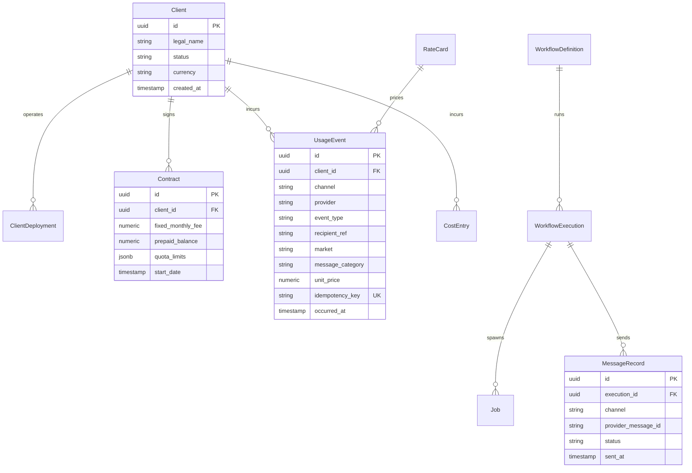

# Pathixo Flow - Technical Design Specifications

## 1. Domain Entities & Database Schema

The core persistence layer (PostgreSQL) is managed through relational schemas enforcing strict client scoping and auditability:



---

## 2. Shared Packages Specifications

### 2.1 `packages/configuration`
* **Purpose**: Safe runtime configuration loading and schema validation.
* **Key Invariant**: Uses **Zod** schemas. If any required environment variable (`DATABASE_URL`, `REDIS_URL`, `META_APP_SECRET`, etc.) is missing or malformed, the process immediately halts on boot with a structured error.
* **Secret Redaction**: Config inspection utilities automatically mask sensitive keys (`TOKEN`, `SECRET`, `PASSWORD`, `KEY`).

### 2.2 `packages/queue` & `packages/retry`
* **Purpose**: Durable asynchronous worker processing backed by Redis and BullMQ.
* **Worker Isolation**: Separate named queues for `whatsapp-inbound`, `whatsapp-outbound`, `email-outbound`, and `billing-events`.
* **Idempotency Check**: Workers atomically verify an idempotency lock key in Redis (`SETNX`) before executing side-effects.

### 2.3 `packages/billing-core` (P0 Foundation)
* **Purpose**: Immutable usage metering, rate card management, and cost attribution.
* **Rate Cards**: Versioned, effective-dated data structures:
  - Meta India Marketing rate: ₹0.8631
  - Meta India Utility/Auth rate: ₹0.1150
  - Amazon SES base rate: \$0.10 / 1,000 emails
* **Billing Event Ingestion**: Generates an immutable `UsageEvent` for every accepted dispatch, ensuring zero unbilled consumption.

---

## 3. Provider Adapter Interfaces

All outbound communication is abstracted through interfaces to ensure high maintainability:

```typescript
export interface WhatsAppProvider {
  verifyWebhook(signature: string, payload: Buffer): boolean;
  parseWebhookEvent(body: unknown): NormalizedWebhookEvent;
  sendTemplate(params: WhatsAppTemplateParams): Promise<DispatchResult>;
  sendTextMessage(params: WhatsAppTextParams): Promise<DispatchResult>;
}

export interface EmailProvider {
  sendEmail(params: EmailDispatchParams): Promise<EmailDispatchResult>;
  parseEventWebhook(body: unknown): NormalizedEmailEvent;
}
```
